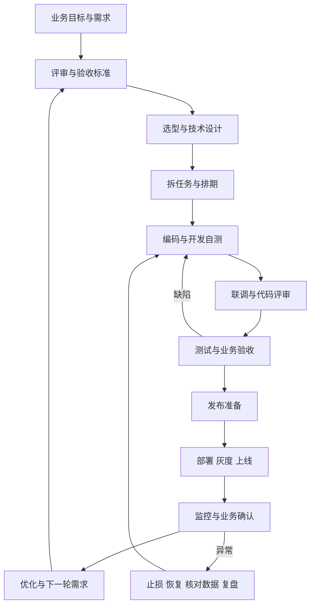

# Java 后端实际开发全流程指南

> 适用场景：已经入职，参与公司业务系统开发，以 Java 后端为主。整理日期：2026-10-25。
>
> 这份指南从真实任务出发，按“输入是什么 → 谁参与 → 怎么做 → 用什么 → 交付什么 → 怎样算完成”展开。正文中的订单、任务编号、排期和指标均为教学示例，不代表你公司的实际规定。

先记住一件事喵：**实际开发的基本单位，是一个经过澄清、实现、验证、发布并确认业务效果的需求。** 写完接口只是其中一步。你作为后端开发需要掌握自己负责的工作，也要知道前后环节找谁、交接什么。


## 内容导航

目录使用 Obsidian 的内部标题链接；导入后可点击跳转，也可使用大纲面板。其他 Markdown 阅读器可通过标题搜索阅读。

**[[#导读：先建立工作顺序|导读：先建立工作顺序]]**

- [[#0.1 阅读方式与适用边界|0.1 阅读方式与适用边界]]
- [[#0.2 先用一张全景表建立顺序|0.2 先用一张全景表建立顺序]]
- [[#0.3 不同团队的流程会怎样分支|0.3 不同团队的流程会怎样分支]]
- [[#0.4 全书贯穿的业务例子|0.4 全书贯穿的业务例子]]

**[[#第一编：需求、任务与技术选型|第一编：需求、任务与技术选型]]**

- [[#1.1 先看清交付链：你交付的究竟是什么|1.1 先看清交付链：你交付的究竟是什么]]
- [[#1.2 刚进入公司：先接通工作环境，再理解一条业务|1.2 刚进入公司：先接通工作环境，再理解一条业务]]
- [[#1.3 需求会议：把“加一个按钮”变成确定的行为|1.3 需求会议：把“加一个按钮”变成确定的行为]]
- [[#1.4 禅道等工具：需求怎样落到你的工作列表|1.4 禅道等工具：需求怎样落到你的工作列表]]
- [[#1.5 排期与协作：估的是交付工作，不只是敲代码|1.5 排期与协作：估的是交付工作，不只是敲代码]]
- [[#1.6 快速开发选型：选底座时究竟比较什么|1.6 快速开发选型：选底座时究竟比较什么]]
- [[#1.7 架构与中间件：按业务压力增加复杂度|1.7 架构与中间件：按业务压力增加复杂度]]
- [[#1.8 接入第三方：开发之前就要把账号、协议和异常说清|1.8 接入第三方：开发之前就要把账号、协议和异常说清]]
- [[#1.9 从需求阶段交给开发阶段的准备清单|1.9 从需求阶段交给开发阶段的准备清单]]

**[[#第二编：设计、编码、测试与代码交付|第二编：设计、编码、测试与代码交付]]**

- [[#2.1 领到任务后，第一件事是确认“改什么，以及怎么算完成”|2.1 领到任务后，第一件事是确认“改什么，以及怎么算完成”]]
- [[#2.2 开发环境：先稳定复现现有系统，再开始修改|2.2 开发环境：先稳定复现现有系统，再开始修改]]
- [[#2.3 技术设计：先确定数据和规则，再确定类与方法|2.3 技术设计：先确定数据和规则，再确定类与方法]]
- [[#2.4 并发、事务、幂等和外部调用：真实开发最容易漏的部分|2.4 并发、事务、幂等和外部调用：真实开发最容易漏的部分]]
- [[#2.5 代码具体怎么编写|2.5 代码具体怎么编写]]
- [[#2.6 联调：确认两个模块真的能合作|2.6 联调：确认两个模块真的能合作]]
- [[#2.7 测试：开发自测、自动化与测试同事各做什么|2.7 测试：开发自测、自动化与测试同事各做什么]]
- [[#2.8 Git：如何从本地改动变成可审查的团队代码|2.8 Git：如何从本地改动变成可审查的团队代码]]
- [[#2.9 CI：让“我本地能跑”变成团队可复现的结果|2.9 CI：让“我本地能跑”变成团队可复现的结果]]
- [[#2.10 提测与 Bug 闭环：把代码交接给下一位参与者|2.10 提测与 Bug 闭环：把代码交接给下一位参与者]]
- [[#2.11 交付前开发者最后自查|2.11 交付前开发者最后自查]]

**[[#第三编：部署、上线、监控与持续优化|第三编：部署、上线、监控与持续优化]]**

- [[#3.1 先理解交付边界：合并、部署、发布、上线验收分别是什么|3.1 先理解交付边界：合并、部署、发布、上线验收分别是什么]]
- [[#3.2 环境怎么分：从本地到生产，究竟隔离什么|3.2 环境怎么分：从本地到生产，究竟隔离什么]]
- [[#3.3 CI/CD 如何把一次提交变成可上线版本|3.3 CI/CD 如何把一次提交变成可上线版本]]
- [[#3.4 部署方式怎么选：不要求每个项目都上 Kubernetes|3.4 部署方式怎么选：不要求每个项目都上 Kubernetes]]
- [[#3.5 配置、网络、域名和安全：上线单里经常漏掉的部分|3.5 配置、网络、域名和安全：上线单里经常漏掉的部分]]
- [[#3.6 数据库变更：为什么上线不能只考虑应用版本|3.6 数据库变更：为什么上线不能只考虑应用版本]]
- [[#3.7 发布策略：什么时候停机，什么时候逐步放量|3.7 发布策略：什么时候停机，什么时候逐步放量]]
- [[#3.8 一份能直接改用的发布单与上线检查表|3.8 一份能直接改用的发布单与上线检查表]]
- [[#3.9 监控怎么建：技术健康和业务成功都要看|3.9 监控怎么建：技术健康和业务成功都要看]]
- [[#3.10 线上故障：先恢复业务，再把原因查完整|3.10 线上故障：先恢复业务，再把原因查完整]]
- [[#3.11 代码与性能优化：从证据出发，保留前后对比|3.11 代码与性能优化：从证据出发，保留前后对比]]
- [[#3.12 压测、容量上限与成本：不只问能扛多少 QPS|3.12 压测、容量上限与成本：不只问能扛多少 QPS]]
- [[#3.13 长期运维：补丁、灾备、证书和交接都属于开发闭环|3.13 长期运维：补丁、灾备、证书和交接都属于开发闭环]]
- [[#3.14 功能与系统下线：全流程的最后一段|3.14 功能与系统下线：全流程的最后一段]]
- [[#3.15 Java 后端在这一阶段每天到底做什么|3.15 Java 后端在这一阶段每天到底做什么]]

**[[#第四编：扩展分支、完整实战与工作模板|第四编：扩展分支、完整实战与工作模板]]**

- [[#4.1 扩展分支：前端、移动端与多系统协作|4.1 扩展分支：前端、移动端与多系统协作]]
- [[#4.2 扩展分支：SaaS、多租户、批处理与数据任务|4.2 扩展分支：SaaS、多租户、批处理与数据任务]]
- [[#4.3 扩展分支：AI / Agent 项目怎样进入正常研发流程|4.3 扩展分支：AI / Agent 项目怎样进入正常研发流程]]
- [[#4.4 一个需求从接单到关闭的完整实战|4.4 一个需求从接单到关闭的完整实战]]
- [[#4.5 常见分叉：临时插单、线上 Bug、重构和数据修复|4.5 常见分叉：临时插单、线上 Bug、重构和数据修复]]
- [[#4.6 可直接复用的沟通与交付模板|4.6 可直接复用的沟通与交付模板]]
- [[#4.7 新人最值得先熟练的工作顺序|4.7 新人最值得先熟练的工作顺序]]
- [[#4.8 需要向公司确认的信息|4.8 需要向公司确认的信息]]
- [[#4.9 常用术语对照|4.9 常用术语对照]]


## 导读：先建立工作顺序

### 0.1 阅读方式与适用边界

- **第一次读：**先看全景、角色、禅道流转和贯穿案例，建立工作顺序；再看开发测试、发布监控。
- **正在领任务：**按需求澄清、代码定位、设计、自测、提测、提交评审的顺序对照执行。
- **正在参与上线：**直接查发布、数据库迁移、回滚、观察和故障处理章节。
- **正在选型：**先看限制条件，再看快速开发框架、架构和第三方服务；工具清单是候选池，不是必须全部安装的清单。
- **长期查阅：**文末提供实际任务闭环、沟通模板、检查清单、术语和需向公司确认的信息。Markdown 可直接导入 Obsidian，通过大纲面板跳转。

已确认你的用途是公司 Java 后端工作。公司的规模、版本、发布权限暂未确认，因此以下按 Java / Spring Boot 主线展开，兼顾 Vue 前端、微服务和 AI / Agent 扩展；同时保留小团队与较规范团队、存量项目与新项目的分支。文中“上线”也包含你原话中可能指的“容量上限”：压测、容量评估、扩缩容和资源成本。

本文描述常见工程实践与可选方案，不声称所有公司使用同一套流程。具体工具版本、商业功能、开源许可、云服务支持范围，以所选版本的官方文档和公司采购规则为准。文内官方链接用于核验关键能力；步骤、案例和表格为围绕本场景的综合整理。

### 0.2 先用一张全景表建立顺序

| 阶段 | 你会实际做什么 | 主要产物 | 下一步开始前要确认什么 |
| --- | --- | --- | --- |
| 业务发现与立项 | 听业务痛点、识别用户、确认目标与约束 | 问题说明、目标、范围、优先级 | 值不值得做，谁拍板，成功怎么衡量 |
| 需求与原型 | 看流程图、页面、字段、状态、权限、异常 | 需求说明、原型、验收条件 | 正常与异常规则已明确，争议有责任人 |
| 需求评审 | 提问、补边界、找外部依赖、确认版本范围 | 评审记录、待办、变更记录 | 开发与测试能描述同一件事 |
| 选型与技术设计 | 沿用或选择脚手架、设计模块/API/表/事务 | 技术方案、接口契约、迁移方案 | 关键风险有验证结果，方案能维护 |
| 任务拆解与排期 | 在禅道等工具领任务、估时、标依赖和阻塞 | 迭代计划、负责人、任务卡 | 一个任务的输入输出和完成标准清楚 |
| 环境与代码准备 | 配账号、拉仓库、启动服务、跑基线用例 | 可运行环境、配置说明 | 当前版本原本是否正常已知 |
| 任务实现 | 追调用链，写业务逻辑、数据库操作与测试 | 代码、测试、接口文档、SQL | 规则与数据一致，异常能处理 |
| 联调与开发自测 | 与前端/其他服务核对请求、响应和异常 | 联调记录、自测证据 | 前后端实现同一契约，核心路径可运行 |
| 提交与代码评审 | 检查差异、提交、推送、PR/MR、处理意见 | 可审查的变更、流水线记录 | 质量检查通过，评审认可 |
| 测试与业务验收 | 提测、修 Bug、回归、业务方验收 | 测试报告、缺陷记录、验收结果 | 重要风险已解决或有明确决策 |
| 发布准备 | 固定制品、准备配置/迁移/回滚/监控 | 发布单、制品标识、执行步骤 | 谁执行、何时停、如何恢复已明确 |
| 部署与上线 | 部署指定版本、健康检查、灰度、开关放量 | 部署记录、线上冒烟结果 | 技术指标和业务指标均正常 |
| 上线观察 | 看错误、延迟、资源、订单与异步任务 | 观察记录、业务确认 | 没有悄悄积压，用户能完成业务 |
| 故障处理 | 接警、定位范围、止损、恢复、核对数据 | 事故记录、修复、复盘行动 | 服务与业务数据均恢复 |
| 持续优化 | 找瓶颈、改 SQL/代码/配置、验证收益 | 基线、对比结果、技术债任务 | 有实测改进，未引入功能回退 |
| 运维与生命周期 | 升级依赖、续证书、恢复演练、迁移与退役 | 运维手册、演练记录、归档 | 有负责人，成本与风险可控 |



这些步骤会交错：测试可以提前设计用例，前后端可以按契约并行，运维应在设计阶段确认部署条件。图示表示主要依赖关系，不要求所有人排队等上一步彻底结束。

### 0.3 不同团队的流程会怎样分支

| 场景 | 通常如何安排 | 最容易遗漏的地方 |
| --- | --- | --- |
| 小团队、内部管理系统 | 产品或负责人澄清需求；后端兼做部分测试和部署；简化审批与文档 | 没有独立测试时，应明确由谁复核关键业务；不能让发布和恢复全靠一个人的记忆 |
| 较规范的产品研发团队 | 产品、研发、测试、平台/运维分别负责；需求、代码、测试、发布记录相互关联 | 交接只说“做完了”，没有版本、范围、证据和遗留问题 |
| 大组织或关键交易系统 | 更正式的架构评审、安全检查、变更窗口、审计和灾备 | 审批多不代表验证充分；仍需可执行的恢复步骤和数据核对 |
| 项目制、外包或交付型项目 | 合同范围、里程碑、客户验收、交付文档和部署培训更突出 | 客户现场网络、授权、机器资源和数据迁移准备过晚 |
| 持续迭代的互联网产品 | 小批量交付、自动化、功能开关、灰度与数据反馈更重要 | 放量后只看接口成功，不看用户体验和真实业务转化 |
| 维护存量系统 | 优先理解现有规范和依赖，小范围修改并补回归 | 一上来换框架，导致变化范围超过任务本身 |
| 新建系统 | 先确认需求与运行约束，再做最小业务闭环和工程基线 | 为不确定的未来引入大量服务、中间件和平台 |

敏捷团队可能按一到两周或其他周期安排迭代，也可能用持续拉取任务的看板；项目制可能按阶段验收。周期长短只是安排方式，关键是任务可追踪、范围可调整、结果可验证。

### 0.4 全书贯穿的业务例子

示例需求：“用户可以取消符合条件的订单；已付款时发起退款，并能查询处理结果。”

- 未支付：需要处理取消与支付的并发，确认规则后取消订单，释放已经预占的库存；没有预占就不能凭空加库存。
- 已支付未发货：按规则生成退款申请，处理中显示“退款中”；外部渠道确认成功后才更新为退款完成。
- 已发货：本示例不允许直接取消，提示走售后；真实项目可以采用其他规则，必须在需求中确认。
- 重复点击、网络超时、回调重复或迟到、库存服务异常，都属于开发与测试范围。

后文会把这个需求关联到任务卡、接口、事务与状态、测试用例、Git 变更、发布单、监控和复盘，让你看到一个任务怎样从会议走到线上。

---

## 第一编：需求、任务与技术选型


> 阅读定位：面向已入职、以 Java 后端为主的开发者。这里的团队、编号、业务规则和排期均为教学示例，不代表你所在公司的规定。工具是候选方案，优先沿用公司已维护的体系；具体版本、插件、商业授权和部署能力需按实际产品核对。

### 1.1 先看清交付链：你交付的究竟是什么

真实研发的起点通常是“业务出现问题或机会”：客服每天处理大量取消订单、业务希望缩短退款处理时间、客户要求新增一个审批环节、某个页面过慢。研发要把这些诉求变成可验证、可运行、有人维护的系统行为。

一条完整链路是：

```text
业务问题/用户反馈
  → 收集与判断价值
  → 明确范围、规则、验收标准
  → 评审技术影响与资源
  → 排期、分工、建任务
  → 接口/数据/交互/异常方案
  → 开发、自测、代码评审、联调
  → 测试、验收、发布准备
  → 部署、上线验证、观察
  → 监控、支持、故障响应
  → 复盘、优化、下一轮需求
```

这条链并非只能顺序走一遍。评审发现需求冲突会退回澄清，联调发现接口不合理会调整契约，测试发现历史数据问题会补迁移方案，上线监控发现回归会暂停放量或回滚。需要留下“为什么调整、谁确认、哪些内容受影响”的记录。

#### 1.1.1 角色如何配合

| 角色 | 主要回答的问题 | 通常提供什么 | Java 后端需要怎样配合 |
| --- | --- | --- | --- |
| 业务负责人/客户 | 为什么做，哪些结果才有价值 | 场景、规则、优先级、业务验收 | 把技术限制翻译成业务影响，不自行决定退款规则 |
| 产品经理/需求分析师 | 做哪些能力、界面和规则 | 需求说明、原型、验收标准 | 指出缺失状态、权限、异常、历史兼容问题 |
| 项目经理/交付负责人 | 谁在什么时候完成什么 | 里程碑、排期、依赖协调 | 提供可信估时、阻塞和风险，不等延期当天汇报 |
| 技术负责人/架构师 | 如何做得可维护、可运行 | 架构约束、评审结论、技术取舍 | 按现有规范实施；重大改变先给可比较方案 |
| 前端/客户端 | 用户怎样操作、看到什么 | 页面、交互、接口调用 | 共同确定字段、状态码、分页、错误提示和联调数据 |
| 后端开发 | 业务规则怎样可靠执行 | 服务、接口、数据变更、测试、排障信息 | 对权限、数据一致性、异常和可观测性负责 |
| 测试/QA | 结果是否满足约定且未破坏旧行为 | 用例、缺陷、测试报告、质量风险 | 自测后提测，提供版本、配置、数据和影响范围 |
| 运维/SRE/平台工程 | 系统怎样发布、观察和恢复 | 环境、流水线、监控、备份、运行规范 | 提供健康检查、资源需求、变更步骤与回滚条件 |
| DBA/数据负责人 | 数据怎样安全演进、查询怎样稳定 | SQL 审核、索引建议、备份恢复方案 | 提交可审核的迁移和回填方案，说明锁表与容量影响 |
| 安全/合规/采购等 | 接入、权限、授权是否满足组织要求 | 安全基线、采购和使用边界 | 在新三方、新数据用途出现时提前协调 |

小团队可能一人兼数职；职责仍然存在。例如没有专职测试时，也要明确谁验收；没有专职运维时，也要明确谁查看告警、谁执行恢复。不能把“没人担任这个职位”理解为“这一环节可以消失”。

#### 1.1.2 每个阶段应留下的证据

| 阶段 | 主要输入 | 最小交付物 | 可以进入下一阶段的条件 |
| --- | --- | --- | --- |
| 需求确认 | 业务诉求、现状数据 | 范围、业务规则、验收标准 | 不存在阻碍实现的关键歧义 |
| 技术设计 | 已确认需求、现有系统 | 影响清单、接口/数据/异常方案 | 关键风险有人确认、依赖有负责人 |
| 开发 | 任务、设计、环境 | 代码、迁移、配置、自测记录 | 自测通过，变更可被他人审阅 |
| 联调/测试 | 可追溯构建、接口、测试数据 | 联调结果、用例执行和缺陷记录 | 阻断问题已处理，遗留风险已明确 |
| 发布 | 候选版本、测试结论 | 发布单、操作步骤、回滚/补偿方案 | 人员、环境、依赖和观测准备齐全 |
| 上线验收 | 实际部署结果 | 冒烟证据、指标、业务确认 | 用户关键路径可用，观察指标正常 |
| 持续运营 | 指标、告警、反馈 | 故障/优化任务、复盘与跟踪 | 改进有负责人、期限和验证方式 |

“代码已经提交”只表示一个交付物产生了；“开发完成”“测试通过”“业务上线”“任务关闭”是不同节点。团队应明确各节点由谁改变状态，避免把进度显示得比实际更靠前。

### 1.2 刚进入公司：先接通工作环境，再理解一条业务

#### 1.2.1 接手存量项目的顺序

输入是现有系统、代码库和入职任务；参与者是你、带教或模块负责人、平台支持。目标是能在授权的开发环境运行、定位、修改、验证一条业务，而不是第一天读完整个仓库。

**第一步：弄清系统和人员地图。** 列出系统用途、用户群、核心模块、上下游服务、各模块负责人、值班或支持渠道。知道“订单谁负责、支付谁负责、测试环境故障找谁”，通常比先背所有类名更有用。

**第二步：拿到必要账号和最小权限。** 常见清单包括公司邮箱/IM、VPN 或零信任接入、Git 平台、禅道等任务系统、文档平台、开发/测试环境、制品库、接口平台、日志和监控平台。权限按工作需要申请；不把生产密钥复制到个人配置中，不用同事账号作为长期方案。

**第三步：以仓库文件为准确认版本。** 查看 README、构建文件、Maven Wrapper/Gradle Wrapper、父 POM、BOM、JDK 配置、前端锁文件、容器文件和流水线。记录实际 JDK、Spring Boot、数据库、中间件、Node 和包管理器版本。不要看一篇新教程就升级公司工程，也不要为了本地跑通随意删除依赖和测试。

**第四步：准备可重复的本地环境。** 使用公司安装包或可信来源安装 IDE、Git、JDK、构建工具、数据库客户端和 API 客户端；按 README 获取脱敏开发配置。数据库、Redis、MQ 可以连接隔离的共享开发环境，也可以通过团队提供的容器配置启动。共享环境要区分自己的数据、队列、缓存前缀，避免测试相互干扰。

**第五步：跑通现有能力。** 先不改业务代码：构建成功、服务启动成功、登录成功、一个查询接口能返回预期数据，再执行现有关键测试。记录启动命令、必要环境变量、依赖地址的来源和常见故障。密码只记录获取方式，不写进普通文档。

**第六步：沿一条请求读代码。** 从“订单详情页”入手，用浏览器网络面板确认接口，再沿以下路径查找：

```text
页面按钮/请求 → 网关或反向代理 → 登录与权限校验
→ Controller → Service/领域逻辑 → Mapper/Repository
→ SQL/缓存/外部接口 → 返回对象 → 页面展示
```

同时看日志中的请求标识、相关表、状态字段和异常处理。拿一笔测试订单，解释它从哪里来、谁能看、状态如何变化，理解会比只看目录结构扎实。

**第七步：完成一个低风险、范围小的任务。** 例如补一个明确校验、修复一个查询条件、调整一个返回字段。完整走一次分支、提交、评审、测试和发布流程，暴露协作或环境问题。

这一阶段的产物可以是一页《项目运行与调用链笔记》，含启动方式、环境依赖、模块入口、测试方式、团队流程和待确认问题。完成标准是：换一个同事照笔记能跑起来，你能解释自己的小改动影响了哪里。

#### 1.2.2 新建项目要额外做什么

绿地项目需要先确定业务目标、用户规模、数据敏感程度、可用性要求、交付日期和维护者，然后选择已有内部底座、快速开发框架或自行搭建。初始化的不只是业务包，还包括：

- 仓库归属、默认分支、保护规则、评审责任人和许可证/版权说明。
- 构建和依赖版本、代码格式、目录约定、日志、异常、配置管理。
- 数据库迁移、测试基础、环境隔离、CI、制品版本和发布路径。
- 登录授权、数据权限、审计需求、接口文档、健康检查和基础监控。
- README、系统简图、关键设计决定和接入方联系人。

可以先交付一条“登录后查询一条业务数据”的纵向链路，让前端、后端、数据库、测试和部署真正连起来，再逐步扩展模块。只有工程能在自己电脑启动，还不能说明项目底座已经可用。

### 1.3 需求会议：把“加一个按钮”变成确定的行为

贯穿本指南的例子是“用户取消订单”：未支付订单允许取消并归还预占库存；已支付订单发起退款申请，先进入退款处理中，最终结果异步确认；已发货订单通常不允许直接取消，应引导售后。这里采用的是示例规则，真实项目必须由业务方确认。

#### 1.3.1 需求从哪些地方来

常见来源有业务规划、客户合同、客服工单、用户反馈、运营活动、数据分析、安全整改、线上故障和技术债。通常先进入需求池，再按价值、紧迫程度、成本、风险和依赖排序。开发者发现的慢 SQL 或重复代码也可以形成任务，但需要说清影响和收益。

需求池不等于本期承诺。产品可能先写“支持取消订单”，评审后才确定哪些状态、哪些用户、哪个端、哪一期实现。对交付型项目，还要区分合同范围、变更范围和后续维护范围；这些范围由相应负责人确认。

#### 1.3.2 会议前，后端怎样准备

拿到需求说明或原型后，先自己走一遍现有流程，找相似实现，列出疑问。不要等会议里才第一次打开原型。重点准备：

| 维度 | 订单取消要问的具体问题 |
| --- | --- |
| 谁可以做 | 订单本人、客服、商家、管理员分别有什么权限？是否跨租户？ |
| 什么状态能做 | 未支付、已支付、备货中、已发货、已完成、退款中分别怎样处理？ |
| 时间边界 | 支付后多久可取消？使用哪个时区？临界时间按哪个服务的时间判定？ |
| 金额与权益 | 运费、优惠券、积分、礼品卡、部分退款、部分商品如何处理？ |
| 库存 | 哪个环节占库存？何时释放？取消与发货同时发生谁获胜？ |
| 第三方 | 支付、仓库、物流是否要同步？外部失败时向用户显示什么？ |
| 重复与并发 | 连点、网络重试、两个客服同时操作如何保证只执行一次？ |
| 数据范围 | 历史订单是否支持？旧客户端是否继续工作？旧订单缺字段怎么办？ |
| 页面体验 | 操作后立即成功还是显示处理中？失败能否重试？有哪些可理解的提示？ |
| 结果确认 | 谁验收？以页面、数据库、支付平台还是对账结果为准？ |
| 非功能 | 预计峰值、延迟、审计、日志保留、可用性、故障恢复需要达到什么水平？ |

有疑问时给出具体场景比问“需求清楚吗”有效。例如：“用户支付成功，但支付回调尚未到达，此刻点击取消，应该等待查单还是进入处理中？”这是能影响状态机、事务和测试设计的问题。

#### 1.3.3 需求评审会怎样开

通常由产品说明背景、用户流程和本次范围，前端确认交互，后端确认业务和数据约束，测试从边界与验收角度补充，技术负责人判断依赖和风险。涉及支付、仓储等系统时，要提前邀请对应负责人或形成待确认事项。

会议可以按这个顺序推进：

1. 明确问题和目标，例如减少客服人工取消量，而非仅“上线按钮”。
2. 走正常用户流程，说明每一步的输入、状态和输出。
3. 走异常、重复、权限、并发和外部失败场景。
4. 确认本期范围与明确不做的范围，例如一期不支持部分商品取消。
5. 确认前后端、测试、运维和第三方依赖。
6. 写可验证的验收标准，列出待决问题、负责人和期限。
7. 评估是否具备进入排期的条件；技术未知较多时先做短时验证任务。

会上口头通过不等于所有人理解一致。会后更新需求正文与原型，记录结论和关键变更，让开发和测试看到同一版本。没有决定的问题要写成“待谁在何时确认”，不要藏在聊天记录中。

#### 1.3.4 验收标准怎样写

下面是示例，不是已经确认的公司规则：

```text
场景 A：本人取消未支付订单
前提：订单属于当前用户，状态为未支付，存在预占库存。
动作：用户提交取消请求。
结果：订单进入已取消；预占库存只释放一次；记录操作者和原因。
重复动作：再次提交得到可解释的已取消结果，不再次增加库存。

场景 B：取消已支付、尚未发货的订单
前提：订单可退款，金额与支付记录一致。
动作：用户发起取消。
结果：系统生成可追踪的退款记录，页面显示退款处理中。
最终结果：通过可信回调或主动查询确认后更新退款状态。
异常：请求超时不能直接当作退款失败，也不能换新退款单号盲目重试。

场景 C：越权和发货竞争
其他用户无法通过更换订单编号取消该订单。
取消和发货并发时只能出现业务允许的状态迁移，不出现已发货又直接取消。
```

除了功能，还可以有经过共同确认的性能、可靠性和审计标准，例如“在约定数据量与负载下，取消受理接口的 P95 延迟不超过约定阈值”。阈值必须有业务背景和测试环境说明，不能随手写一个漂亮数字。

#### 1.3.5 临时插需求如何处理

先判断是理解补充、缺陷修复，还是范围变更。若原标准要求“只能本人取消”，没有做权限校验是缺陷；原标准只支持整单取消，临时要求部分商品退款通常是新增范围。

处理顺序是：记录变化 → 评估接口、数据、代码、测试和发布影响 → 给出增加工作量与替代方案 → 由范围/优先级负责人决定 → 更新需求和关联任务。可以选择延期上线、减少其他范围、分期交付或增加可实际投入的人员，但不能仅在群里答应后默默增加工作。

禅道提供需求变更与评审机制，并能关联查看受影响的任务、Bug 和用例；具体状态和评审规则取决于版本与配置。使用时应同步确认受影响对象，而非只改需求标题。[禅道需求变更说明](https://www.zentao.net/book/zentaopms/81.html)、[禅道需求评审说明](https://www.zentao.net/book/zentaopms/640.html)

### 1.4 禅道等工具：需求怎样落到你的工作列表

#### 1.4.1 先分清对象，避免把所有东西都叫任务

禅道的产品、项目与执行分别承接产品目标、交付组织和具体迭代/阶段；可使用的管理模型和页面名称随版本配置变化。下面用常见团队的工作语义说明，不要求照搬界面按钮。[禅道框架概念](https://www.zentao.cn/zentao-basicfunction/zentao-use-327.html)、[维护项目和执行](https://www.zentao.net/book/zentaopms/517.html)

| 对象 | 实际含义 | 订单取消示例 |
| --- | --- | --- |
| 产品 | 长期演进的业务系统或产品线 | 交易平台 |
| 需求 | 要交付的用户/业务能力 | 用户可取消符合规则的订单 |
| 项目 | 一次有目标、资源和期限的交付组织 | 交易体验改造 |
| 执行/迭代 | 项目中的冲刺、阶段或执行单元 | 第三期迭代 |
| 任务 | 某个人或协作组要完成的具体工作 | 实现取消接口与幂等控制 |
| Bug | 实际行为偏离已确认预期 | 重复请求导致库存释放两次 |
| 用例 | 验证某个行为的步骤与预期 | 已发货订单取消被拒绝 |
| 版本/构建 | 一组可定位的代码和交付物 | 包含指定提交的候选构建 |
| 测试单/测试轮次 | 针对某版本组织的一次测试 | 订单取消第一轮系统测试 |
| 发布 | 面向目标环境/用户交付的版本记录 | 本次生产发布及包含的需求、修复 |

禅道能够把版本与提测关联，维护用例、Bug、测试单及报告；实际使用时把它们连起来，才方便追溯“哪个构建包含哪个修复”。[禅道测试对象说明](https://www.zentao.net/book/zentaopms/484.html)

你需要建立的追溯链是：

```text
需求编号 → 任务/缺陷编号 → 分支与提交 → 合并请求
→ 流水线构建 → 测试版本与结果 → 发布记录 → 上线验证
```

关联方式可能是平台自动解析，也可能是链接和命名约定。先看公司的规则；不要假定提交信息写一个编号就自动关闭了任务。

#### 1.4.2 从任务下发到关闭的日常动作

1. 产品或负责人将评审后的需求放入计划，项目负责人建立迭代。
2. 研发与测试共同拆解任务，确认每项负责人、依赖、估时和验收标准。
3. 任务指派给你，或按团队约定由你领取；先读需求和关联资料。
4. 检查前置依赖与完成标准，不清楚就提问；工作开始后更新状态。
5. 实施时把关键结论、阻塞和预计剩余工作写入任务，必要时关联设计或提交。
6. 自测、评审和联调后，按团队规则标记开发完成并提供提测信息。
7. 测试发现缺陷时建立 Bug，说明版本、步骤、预期与实际结果；修复后重新验证。
8. 完成测试、业务验收和发布条件后，由约定角色关闭任务或需求。

常见语义是“未开始 → 进行中 → 开发完成/待验证 → 验证通过 → 关闭”，但这不是所有禅道版本的默认状态机。某些团队把“评审中”“待提测”作为标签或自定义字段，另一些团队在任务完成后单独跟踪测试和需求状态。必须先确认你们的定义。

阻塞不是简单写“等前端”。应写明：等待哪个接口或决定、找谁、何时需要、影响哪一天的交付、有没有能并行推进的工作。完成度也不要长期写“90%”，应列剩余事项，如“退款超时补偿未完成，预计还需一次联调”。

#### 1.4.3 一张可以直接参考的任务卡

```text
标题：[后端] 实现用户取消订单及退款受理
所属需求：示例 STORY-238 用户自主取消订单
负责人：指定一位直接负责者；支付协作人为另一个联系人

业务范围：
- 本人未支付订单取消，归还预占库存。
- 已支付未发货订单生成退款申请，返回处理中。
- 已发货及其他不允许状态拒绝直接取消。

实现范围：
- 取消接口、权限与状态校验、并发/重复控制。
- 退款记录及必要的数据迁移。
- 支付适配调用、超时状态查询、回调处理。
- 操作日志、必要指标、接口说明和自动化测试。

不包含：本期不做部分商品退款、跨订单合并退款。
依赖：支付测试账号、回调地址、库存释放接口、前端状态文案。
产物：代码/MR、迁移文件、接口文档、自测证据、提测说明。
验收：对应需求中的正常、越权、并发、重复、超时等场景通过。
风险：支付测试环境准备时间；历史订单缺少渠道交易号。
估时：拆分后填写工作量、依赖等待和联调安排，不只写编码时间。
关联：原型、评审记录、接口、测试用例、合并请求与构建链接。
```

这张卡范围可能对新人过大。可再拆为接口与状态机、退款外部接入、回调与补偿、测试与联调等有边界的子任务。拆分后仍应有一个人对“取消业务整体可用”负责，防止每个人的子任务完成了，组合流程却没人验证。

#### 1.4.4 工具不同，核心信息不变

| 工具类别 | 可选工具示例 | 主要保存什么 | 使用原则 |
| --- | --- | --- | --- |
| 需求与任务 | 禅道、Jira、TAPD、Azure DevOps Boards、GitLab Issues | 范围、负责人、状态、依赖、验收 | 一处作为任务事实来源，避免多套状态互相矛盾 |
| 文档与决策 | 公司知识库、Confluence、飞书文档、语雀、仓库 Markdown | 需求、设计、运行手册、会议结论 | 任务中放链接；明确维护者和适用版本 |
| 原型与交互 | Figma、Axure、墨刀、即时设计 | 页面流程、交互、视觉规格 | 原型补充行为描述，不能替代权限和异常规则 |
| 接口协作 | OpenAPI、Apifox、Postman、团队接口平台 | 契约、示例、Mock、调试集合 | 前后端共同维护，区分不同环境和接口版本 |
| 代码与评审 | GitLab、GitHub Enterprise、Gitee 企业环境等 | 代码、提交、MR/PR、评审记录 | 代码平台负责实现历史，任务平台负责业务跟踪 |
| 即时沟通 | 企业微信、钉钉、飞书、Teams 等 | 快速协调 | 关键决定回写任务或文档，别只留在群里 |

这些是类别候选，功能及订阅能力需要核对。对入职开发者，熟练使用现有的一套流程比同时注册十个工具更有价值。

### 1.5 排期与协作：估的是交付工作，不只是敲代码

#### 1.5.1 怎样拆任务和估工作量

先按可交付行为拆，例如“未支付取消”“退款受理”“退款最终确认”；再在每项下面补设计、代码、测试、联调、数据迁移和发布准备。任务应有独立可验证的结果，但不要拆成大量“创建某个类”这种没有业务意义的小项。

估时可以先拆成：理解与澄清、方案设计、实现、自测、评审修改、联调、提测支持、发布支持。新接触的支付系统或大表迁移应先安排验证任务，减少未知后再承诺日期。工作量与日历时间要分开：你写代码两天，不代表接口权限审批、测试排队和外部联调也只需两天。

一个教学示例：

| 工作项 | 需要考虑的内容 | 影响交付的依赖 |
| --- | --- | --- |
| 澄清与方案 | 状态、权限、退款、库存、历史订单 | 产品与支付负责人回复 |
| 后端实现 | 状态流转、事务、幂等、回调、补偿 | 已有基础模块可复用程度 |
| 前端实现 | 按钮、原因、处理中、失败与重试展示 | 接口契约和文案 |
| 联调与测试 | 多状态、并发、回调、支付超时 | 可控测试数据和支付环境 |
| 发布准备 | 迁移、配置、开关、监控、验证 | 发布窗口与执行人员 |

估时要给假设，例如“已有支付适配层且测试账号可用”；必要时给范围和主要不确定项。不要把所有任务排满到每个人每天 8 小时，会议、评审、线上支持和意外修复都会占用容量。缓冲量由团队历史交付数据和任务风险决定，不必套固定百分比。

#### 1.5.2 常见会议各解决什么问题

| 会议 | 需要达成的结果 | 开发者提前准备什么 |
| --- | --- | --- |
| 需求澄清/评审 | 范围、规则、验收标准明确 | 现有行为、边界和依赖问题 |
| 技术方案评审 | 关键实现、数据演进、风险有共识 | 简图、备选方案、优缺点、失败场景 |
| 迭代计划会 | 本期承诺与团队容量匹配 | 任务拆分、估时、依赖和风险 |
| 每日同步/站会 | 让阻塞尽早得到处理 | 当前成果、下一步、需要谁帮助 |
| 接口/联调会 | 契约与环境一致，问题有归属 | 请求响应、错误码、复现材料 |
| 缺陷分诊 | 判定严重程度、归属和处理顺序 | 影响范围、复现率、临时缓解方法 |
| 发布评审 | 判断是否具备上线条件 | 测试结论、变更、观察、回滚准备 |
| 演示/验收 | 证明业务能力满足约定 | 真实可演示场景和已知限制 |
| 迭代/事故复盘 | 找出可落实的改进 | 事实时间线、数据、根因和跟踪项 |

会议是否独立召开可随团队规模调整，小团队可以合并。会议结束至少要有结论、负责人和待办；无法产生这些结果的同步，优先考虑异步文档。

### 1.6 快速开发选型：选底座时究竟比较什么

#### 1.6.1 先区分几种“快速开发”

**内部脚手架/项目模板**：复用公司已维护的登录、配置、日志、测试、部署和规范；与现有平台兼容往往是最大优势。要确认维护者、升级方法及哪些模块允许修改。

**代码生成器**：根据表或模型生成常规 Controller、Service、Mapper、页面和接口骨架。适合减少重复输入，但生成出来的代码仍需人检查权限、数据范围、状态、事务、索引和接口设计。

**快速开发框架/管理后台底座**：提供账号、角色、菜单、字典、基础审计等通用模块，并配套工程结构。适合管理系统起步，但要付出理解约定、裁剪功能和跟随升级的成本。

**低代码/零代码平台**：通过表单、流程和页面配置交付部分业务。要确认业务能否表达、数据能否导出、代码能否接管、如何版本控制、测试与部署、离开平台后如何迁移。

**AI 辅助开发**：可以辅助生成骨架、解释代码、补用例和整理文档，但仍需要确定需求、验证行为、审查依赖、运行测试与完成评审。它不会自动承担业务和发布责任；公司代码和数据只能进入获准的工具与环境。

#### 1.6.2 常见 Java 底座如何比较

下表中的“适合/代价”是基于功能形态给出的工程判断，并不是官方保证，也不表示已经替你做出采购或生产选型。

| 候选 | 值得考虑的场景 | 选型时重点看什么 | 常见代价 |
| --- | --- | --- | --- |
| 公司已有模板/组件平台 | 同一组织持续开发多个系统 | 与 SSO、日志、流水线、配置和运维是否直接兼容 | 内部文档不足、旧版本包袱、维护响应 |
| RuoYi / RuoYi-Vue 系列 | 通用后台、权限管理、较标准的业务 CRUD | 具体分支、前端版本、权限/数据权限扩展方式、生成器 | 复杂业务要自行设计；不同衍生项目不能视为同一维护主体 |
| ruoyi-vue-pro / 芋道 | 需要较多现成业务与平台模块的管理系统 | 实际所需模块、模块依赖、多租户边界、支付/流程适配 | 功能多意味着理解和裁剪成本；避免全量搬入 |
| JeecgBoot | 表单、报表、流程较多，倾向低代码开发的业务 | 在线配置与生成代码的边界、扩展能力、版本化和交付方式 | 复杂规则接管成本、配置迁移、部分能力授权或交付限制 |
| Spring Boot + 团队选定组件 | 差异化核心业务、已有能力沉淀、需要精细控制 | 团队能否维护权限、审计、工程规范和发布底座 | 起步工作更多，需要自己承担集成与维护 |
| SaaS 低代码/企业表单平台 | 轻量内部审批、采集、报表、短期验证 | 数据位置、访问控制、导出、连接器、费用和退出方案 | 复杂事务、性能调优、平台锁定与定制边界 |

若依官方列出了前后端分离、微服务等不同形态及基础权限、代码生成功能；选择时应明确具体仓库与分支。[若依官方文档](https://doc.ruoyi.vip/)

芋道公开功能列表覆盖工作流、支付等模块；已有模块能减少重复建设，但真实业务规则、第三方账号和运行保障仍需团队实现与验证。[芋道功能列表](https://doc.iocoder.cn/feature/)

JEECG 官方介绍了代码生成、在线表单、流程等低代码能力及不同交付方式；选型时应逐项确认需要的功能属于哪个版本、是否提供源码以及授权条件。[JEECG 官方低代码介绍](https://bbs.jeecg.com/lowcodeIndex)

#### 1.6.3 做一次小验证，再决定

不要只看演示站或功能数量。用候选框架实现一条有代表性的业务：登录、组织/租户隔离、订单列表、复杂筛选、取消状态流转、导出或审批、测试和部署。让未来维护它的人一起试。

验证清单建议包括：

1. **业务匹配**：需要改核心源码才能做，还是通过公开扩展点即可？
2. **可理解性**：新人能否定位一条请求？异常、权限、事务是否清楚？
3. **工程能力**：能否自动构建、测试、迁移数据库和发布到现有环境？
4. **安全边界**：接口授权与行级数据范围是否可审查？跨租户请求怎样测试？
5. **演进能力**：上游升级时自己的业务代码是否容易冲突？是否能裁剪未用模块？
6. **运行成本**：需要多少服务、内存、外部依赖、平台费用和维护人力？
7. **授权和供应链**：具体版本许可、依赖、二次分发、商用功能及漏洞修复渠道是什么？
8. **退出能力**：数据、配置、流程、页面和代码能否导出或逐步替换？

写一页决策记录：背景、候选、验证结果、选中理由、接受的代价、未来重新评估的条件。评分表可以辅助讨论，但不能用未经验证的主观打分制造“科学选型”的假象。

#### 1.6.4 使用生成器的正确工作顺序

先理解业务 → 确定表与接口 → 在独立分支生成 → 检查差异 → 补状态、权限、并发与事务 → 补测试 → 评审。生成器更适合资料维护、字典、简单配置等模块。订单取消、退款、扣库存这类行为不能直接等同于“修改 status 字段”的通用更新接口。

尤其检查：前端是否能传入本不应修改的字段、查询是否限定当前用户/租户、导出是否绕过数据权限、批量操作是否逐项校验、生成的 SQL 是否适合真实数据量。再次生成前确认覆盖规则，避免把已手写的业务逻辑覆盖掉。

### 1.7 架构与中间件：按业务压力增加复杂度

#### 1.7.1 单体、模块化单体、微服务三条路线

| 路线 | 常见适用情形 | 组织和代码如何安排 | 需要承担的主要成本 |
| --- | --- | --- | --- |
| 单体应用 | 团队小、业务还在验证、发布节奏统一 | 一个应用部署，可按业务分包 | 代码边界不控制会相互耦合；扩容和发布通常整体进行 |
| 模块化单体 | 模块已较清楚，希望保留较简单运行方式 | 订单、库存、支付等模块有公开接口和依赖规则 | 需要持续约束跨模块访问，明确事务边界 |
| 微服务 | 存在独立团队、部署、扩缩容或故障隔离需求 | 服务独立交付，数据责任明确，通过协议协作 | 网络失败、一致性、契约、发布顺序、观测与运维复杂度 |

“有几个 Maven 模块”不直接等于微服务，“跑在多个实例上”也不直接等于微服务。服务拆分应服务于实际的部署、团队和运行需求。模块化单体可以先用清晰包结构与规则实现；如果需要自动验证边界，Spring Modulith 提供模块识别、验证和模块测试等支持，但采用它不是做好模块化的前提。[Spring Modulith 官方介绍](https://spring.io/projects/spring-modulith/)

对订单取消：如果订单和库存处于同一数据库且由同一应用维护，可以设计在合适的本地事务内完成；如果分属独立服务，应设计明确的状态推进、幂等请求、消息/任务、补偿和对账。外部支付不会因为给 Java 方法加上事务注解就自动与本地数据库成为一个事务。

#### 1.7.2 每增加一个组件，都问它解决哪个问题

| 能力 | 候选示例 | 何时可能需要 | 引入时必须一起设计 |
| --- | --- | --- | --- |
| 关系数据存储 | MySQL、PostgreSQL、公司指定数据库 | 业务记录、约束、事务和查询 | 结构、索引、迁移、备份、权限、容量 |
| 缓存/短期状态 | Redis 等 | 经证据确认的热点、短期状态共享 | 失效、一致性、故障降级、内存和热点键 |
| 异步消息 | RabbitMQ、RocketMQ、Kafka 等 | 解耦耗时操作、削峰、事件分发 | 重复、乱序、积压、失败重试、死信与补偿 |
| 搜索 | Elasticsearch、OpenSearch 或数据库搜索能力 | 多字段检索、相关性、聚合需求 | 索引同步、权限过滤、重建和一致性延迟 |
| 文件存储 | 云对象存储、公司文件平台、自托管对象存储 | 图片、附件、大文件 | 鉴权、类型与大小、生命周期、备份与访问费用 |
| 定时/后台任务 | 简单调度、XXL-JOB、Quartz、平台任务服务 | 定期对账、超时处理、批处理 | 集群重复执行、幂等、分片、失败恢复、补跑 |
| 配置/服务治理 | 平台配置能力、Nacos、Spring Cloud 相关组件 | 多服务配置与服务发现等需要 | 版本兼容、权限、变更审计、配置失效处理 |
| 工作流 | Flowable 或已有审批平台 | 多角色审批、条件分支、会签、历史追踪 | 流程版本、运行中实例、撤回/驳回、数据与权限 |
| 规则计算 | 配置规则、规则引擎、业务代码 | 规则频繁变化且需统一管理 | 规则版本、测试、解释、回放和性能 |
| API 网关 | 现有网关、Spring Cloud Gateway 等 | 统一入口、路由、认证接入、流量策略 | 业务仍需授权；路由和策略变更需可验证 |

这是能力地图，不是“一套项目必须装齐”的清单。举例：取消订单需要可靠地触发退款，但小团队可以先使用数据库任务记录和后台处理；当吞吐、消费者数量和运维能力达到相应需要时，再评估消息系统。选择 MQ 后，也仍要解决数据库提交与消息发送之间的可靠性。

Flowable 的开源引擎可以执行 BPMN 流程定义并管理流程实例，适合需要显式审批流程的场景；普通订单状态变化是否需要完整工作流引擎，应由业务复杂度判断。[Flowable 官方入门文档](https://www.flowable.com/open-source/docs/bpmn/ch02-GettingStarted/)

### 1.8 接入第三方：开发之前就要把账号、协议和异常说清

#### 1.8.1 三方不只是一个 Maven 依赖

三方接入通常同时涉及产品规则、商务或账号、技术接口、环境网络、安全、联调、上线和后续运维。常见分工是业务/商务确认服务范围和费用，管理员开通账号与应用，后端实现适配，测试验证，运维配置密钥和网络，负责人安排上线与后续支持。

| 接入类型 | 常见服务/实现候选 | 开发前确认 | 实现与验收重点 |
| --- | --- | --- | --- |
| 短信/邮件 | 公司消息平台、云通信、企业邮件服务 | 签名模板、发送资格、额度、测试号码 | 防刷、限流、验证码有效期、一次性使用、失败与费用 |
| 支付/退款 | 微信支付、支付宝、公司支付中台 | 商户主体、支付产品、结算、证书、回调、测试方式 | 金额、验签、幂等、状态查询、对账、退款最终结果 |
| 文件/图片 | 云对象存储、文件中台 | 桶/目录、域名、访问方式、配额 | 上传授权、恶意文件、私有访问、失效、清理与下载 |
| 单点登录/身份 | 企业身份平台、OIDC/SAML 接入 | 应用注册、回调、账号映射、组织同步 | Token 验证、会话退出、权限映射、账号禁用 |
| 企业消息 | 企业微信、钉钉、飞书等开放平台 | 应用权限、接收对象、事件订阅 | 回调验证、重复事件、成员变动、失败重试与通知降级 |
| 物流/地图/电子签章 | 对应行业服务商或公司中台 | 服务范围、账号、授权数据、调用费用 | 业务编号、状态同步、配额、异常、结果可追踪 |
| 工作流/审批 | 内部审批系统、工作流引擎 | 审批模型、人员、组织与数据责任 | 流程实例与业务单据关联、撤销、版本和回调 |
| AI 模型/知识服务 | 获准的模型平台、企业知识平台 | 数据可否发送、模型能力、费用、限额 | 超时、结果校验、权限隔离、评估、成本和回退 |

候选名字只表示类别中的常见选项，不能据此判断你公司的账号具备所有能力。测试/生产环境也未必一一对应：有的平台提供沙箱，有的需要白名单、模拟服务或经批准的小额验证。没有沙箱时要单独设计验证路径，不能把真实交易当普通测试随意执行。

#### 1.8.2 一次完整三方接入的步骤

1. **确认场景与责任**：具体调用哪些 API，数据归谁，失败由谁处理，支持联系人是谁。
2. **阅读官方协议**：请求/响应、认证、签名、金额与时间单位、错误码、重试、回调、配额和版本策略。
3. **申请环境和账号**：测试与生产应用、必要权限、域名/IP 白名单、回调地址、网络连通。
4. **管理密钥**：明确密钥获取、存放、轮换和失效处理；运行时从受控配置获取，代码仓库和日志不保存秘密。
5. **做最小连通验证**：用官方 SDK 或官方示例确认认证和网络；只使用与业务需要匹配的权限。
6. **建立适配层**：业务调用自己的支付/消息接口，三方请求参数、签名和返回解析留在适配层，便于测试与替换。
7. **实现异常策略**：超时预算、连接池、可重试错误、限次退避、限流、熔断/降级按场景确定；写操作重试必须配合幂等。
8. **处理异步和最终状态**：验签、去重、可靠保存、状态推进、补查与对账，不能仅依赖一次回调。
9. **验证业务完成**：除了 HTTP 成功，还要检查实际发送、实际退款、正确收件人或正确权限范围。
10. **准备上线和监控**：切换生产配置、检查证书/域名有效期、调用成功率、延迟、配额、余额和账单。
11. **维护变更**：订阅或定期检查接口变更、SDK 安全更新、证书轮换和服务下线通知，明确跟进人。

对于退款，必须区分“申请已受理”和“最终退款成功”。微信支付 JSAPI 退款接口文档明确要求根据结果通知或查询确定最终状态，并指出重试时复用商户退款单号以避免重复退款；不同支付产品的具体规则应读对应文档。[微信支付退款接口说明](https://pay.wechatpay.cn/doc/v3/merchant/4012791862)

#### 1.8.3 需要提前写入方案的失败场景

- 请求发出前失败：可明确判断未发出的，按规则重试。
- 请求已经到达对方但本地超时：结果未知，使用业务编号查询或幂等重试，不能直接当失败再创建一笔。
- 对方返回受理成功：保留处理中状态，等待可信最终结果。
- 回调重复：幂等处理，重复通知不再产生库存、金额等副作用。
- 回调丢失或延迟：主动查询/对账任务收敛状态，并监控长期处理中记录。
- 三方成功、本地记录失败：保留可恢复线索，由补查/对账修复；不要靠人工猜测改状态。
- 三方限流或服务故障：保护线程和连接资源，按约定降级/排队，向用户返回可理解的处理中或失败结果。
- 密钥或证书失效：监控和轮换流程能及时处理，不能等全部请求失败后才发现。

微信支付回调文档强调通知可能重复、商户应验证签名并结合查询接口确认结果；这类要求需要进入代码和测试计划。[微信支付退款通知说明](https://pay.wechatpay.cn/doc/v3/merchant/4012791865)

### 1.9 从需求阶段交给开发阶段的准备清单

当你准备开始写代码，至少能回答以下问题：

- 这项工作解决谁的什么问题，本次边界是什么？
- 正常、异常、重复、并发和越权时分别应该怎样表现？
- 验收者是谁，用哪些场景证明完成？
- 要改哪些模块、表、接口、配置和外部系统，是否涉及历史数据？
- 前后端契约和联调时间是否明确，是否有可用测试数据？
- 采用什么架构与组件，为什么现有能力不够，需要谁评审？
- 三方账号、权限、回调和网络谁准备，准备时间是否影响排期？
- 任务、分支、提交、测试版本和发布记录如何关联？
- 有没有需要先验证的未知，遇到阻塞该找谁？
- 估时是否覆盖测试、评审、联调和发布准备？

这不意味着必须先写几十页设计才能改一个字段。对小改动，一张任务卡加几条自测项可能足够；对支付、权限、迁移和跨服务状态变更，需要更完整的方案与验证。文档深度应跟随影响范围和失败代价。

---

## 第二编：设计、编码、测试与代码交付


> 本部分以 Java 后端为主，贯穿“订单取消”示例。状态名、任务号、接口和代码都是教学示例，不代表你公司的实际实现。入职后优先沿用公司的框架版本、目录、命名、分支和发布约定，再讨论改进。

### 2.1 领到任务后，第一件事是确认“改什么，以及怎么算完成”

开发真正需要的输入，是已经说明业务规则、页面交互、边界和验收标准的任务。禅道中只写“新增取消订单接口”，还不足以直接开始编码。

先把任务翻译成自己的理解：“用户可以取消自己的未支付订单；已支付且未发货的订单进入退款流程；已发货订单引导售后。重复点击不能重复释放库存或退款。”再把没有答案的问题列出来，与产品、负责人和相关模块开发确认。

#### 2.1.1 把业务规则问成可以判断对错的问题

| 要确认什么 | 订单取消示例 | 不确认会发生什么 |
| --- | --- | --- |
| 谁能操作 | 买家本人、客服、管理员分别能否取消 | 登录成功的用户可能取消他人的订单 |
| 操作对象 | 整单还是部分商品，子订单还是主订单 | 接口设计后发现无法处理部分取消 |
| 哪些状态允许 | 未支付、支付处理中、已支付、发货处理中、已发货 | 取消和付款、发货发生竞态 |
| 操作时间限制 | 超时自动关闭前是否都能取消，活动商品是否特殊 | 后端规则与页面提示冲突 |
| 资产如何变化 | 库存、优惠券、积分、余额分别什么时候退 | 用户的钱退了，券却永远无法使用 |
| 外部系统的影响 | 支付退款、仓储拦截、物流撤回 | 本地显示成功，仓库仍继续发货 |
| 异常如何处理 | 退款请求超时，结果未知时显示什么 | 重试导致重复退款或误判失败 |
| 验收怎么做 | 提供指定状态测试订单、检查数据库和支付结果 | 仅凭页面提示就宣告完成 |

这些问题通常记录在任务讨论、需求说明或接口文档中。口头结论需要补回文档，特别是会影响测试和上线的决定。

#### 2.1.2 在现有代码中追一条完整链路

从页面按钮或已知接口开始，按下面顺序追踪：

```text
页面点击
  → 浏览器请求（URL、方法、参数、登录凭证）
  → 网关路由、鉴权、租户识别
  → Controller 参数接收
  → Service / 应用服务编排
  → 领域规则或已有公共能力
  → Mapper / Repository
  → SQL、事务、数据库变化
  → 消息、缓存、第三方调用
  → 返回值、前端刷新、业务结果
```

具体做法：先在测试环境操作一次现有的相似功能，用浏览器开发者工具的 Network 找接口；在 IDEA 中查找映射和调用；读 Service、Mapper XML 或 ORM 查询；在开发数据库用只读查询核对字段；再看调用链关联的消息消费者、定时任务和操作日志。不要从头逐行读完整个仓库。

同时查看同模块最近的合并请求，通常比只读 README 更容易看到当前代码习惯。问模块负责人：“这个状态还有谁会改？有没有历史兼容逻辑？有没有线上事故相关约束？”

**本阶段产物：**任务理解、涉及模块和表、需要协作的人、尚未确认的问题、粗略改动清单。**可以进入设计的条件：**你能解释正常流程和主要异常流程，并知道哪些结论仍需确认。

### 2.2 开发环境：先稳定复现现有系统，再开始修改

#### 2.2.1 一次性准备清单

| 类别 | 常见工具 | 需要确认的内容 |
| --- | --- | --- |
| 代码与账号 | Git、GitLab / GitHub / Gitee、企业账号 | 仓库权限、默认分支、提交身份、SSH 或组织规定认证方式 |
| Java 开发 | IntelliJ IDEA、项目指定 JDK | `java -version`、IDE 项目 SDK、编译版本、运行 JDK 是否一致 |
| 构建 | Maven / Gradle、Wrapper、Nexus / Artifactory | 使用项目包装器或指定版本，私服和依赖下载权限 |
| 数据访问 | DBeaver、DataGrip、公司数据库平台 | 开发库地址、账号权限、时区、字符集、数据初始化方式 |
| 接口调试 | Apifox、Postman、IDE HTTP Client、curl | 环境变量、测试账号、接口规范和团队共享方式 |
| 本地依赖 | Docker / Compose、共享开发服务 | MySQL、Redis、MQ 等实际版本；容器能力是否可用 |
| 文档与协作 | 禅道、知识库、企业即时通信 | 需求、接口、测试、部署说明放在哪里 |
| 前端联调 | Node.js、项目指定包管理器、浏览器工具 | 版本、锁文件、代理地址、前后端环境对应关系 |

这些工具是候选，安装范围由项目需要决定。公司已经统一 Apifox 时，不必为了学习再维护一套重复的 Postman 集合。

#### 2.2.2 环境与数据必须对应

至少分清本地、共享开发、测试、预发布和生产。小团队可能合并其中一些环境，但应知道每个环境用于什么、数据从哪里来、谁能修改。

本地启动时确认：当前 profile、数据库实例和库名、缓存前缀、消息队列与消费者组、对象存储桶、第三方测试商户号、定时任务是否开启。一个常见问题是本地服务连上共享 MQ 后，把测试环境的消息消费掉了；另一个是本地定时任务批量修改共享数据。

配置采用“可提交的模板 + 环境注入的实际值”。把必填配置项、含义和示例写进 README 或配置模板，密钥通过企业指定的配置中心、密钥系统或本地受控配置提供。不要把真实令牌放进代码、截图、日志、提交记录或公开的 AI 对话。

测试数据优先用脚本、fixture、测试工厂生成。必须使用生产样本时，走公司的授权与脱敏流程。修改共享测试数据前说明范围，避免破坏别人正在验收的场景。

#### 2.2.3 “跑起来”需要达到的标准

能拉取依赖并编译；服务成功启动；测试账号可以登录；一个已有业务接口能走通；能查到对应测试数据；知道日志位置。把缺失步骤补进环境说明。

如果没有容器环境，可使用专属开发数据库或团队隔离的测试实例，但应保证版本接近、数据可重建、账号权限有限；不能因此直接依赖生产数据库。

### 2.3 技术设计：先确定数据和规则，再确定类与方法

简单字段调整可以在任务中写几段说明。涉及支付、库存、权限、消息和跨服务行为时，应先形成短设计文档并评审。设计文档不要求华丽，要求别人能发现问题。

#### 2.3.1 一份够用的设计说明

建议包含：业务目标和不在本次范围的内容；现状与调用链；接口变化；数据表与索引变化；关键状态和时序；事务、并发和幂等方案；外部依赖；兼容与迁移；测试重点；上线与撤回条件。

评审参加者通常是模块负责人、相关后端、前端、测试；高风险改动加支付、数据库或运维负责人。最终留下明确决策和待办，不用把“开过会”当作设计完成。

#### 2.3.2 状态需要表达真实业务事实

订单、支付、退款、履约可能是不同维度。不要为了页面显示方便，把所有状态挤进一个 `status`，再让十几个接口随意写它。

一种示例划分如下，实际系统可以采用其他设计：

| 维度 | 示例状态 | 负责回答的问题 |
| --- | --- | --- |
| 订单 | 待支付、正常、取消中、已取消 | 这笔交易是否继续进行 |
| 支付 | 未支付、支付处理中、已支付、支付失败 | 钱是否已经支付成功 |
| 退款 | 未申请、待提交、处理中、成功、失败待处理 | 退款是否真正完成 |
| 履约 | 未分配、待出库、出库中、已发货 | 商品是否还能阻止交付 |

页面可以显示合成状态，但后端仍应保留足够事实。已支付订单收到“退款申请已受理”，不等于用户已经收到钱；“退款成功”也不自动说明仓库已停止发货。

状态转换要定义触发者、前置条件、允许的下一状态和副作用。尤其考虑三组竞争：取消与支付回调；取消与发货；人工退款与自动重试。涉及同一资源的入口，应遵守共同的并发控制和状态规则，不能只在取消接口里加锁。

#### 2.3.3 API 契约要覆盖前后端真正需要的行为

例如 `POST /api/orders/{orderId}/cancellations`，请求体包含取消原因；身份、租户和数据范围来自可信登录上下文。前端传来的 `userId`、`tenantId` 不能直接作为授权依据。

接口文档至少写清：

1. 请求方法、路径、鉴权方式和业务权限。
2. 字段类型、必填性、长度、枚举、金额单位、时区。
3. 正常返回，以及处理中返回时如何查询后续结果。
4. 业务错误码、HTTP 状态码和页面提示的约定。
5. 幂等键的生成方、作用范围、保存时长及重复请求行为。
6. 并发冲突、限流和超时后的客户端行为。
7. 兼容性：旧客户端缺少新字段时如何处理，枚举新增后是否能正常显示。

不必把所有团队都改成同一种 REST 风格，但错误语义应稳定。使用统一响应包装，也要区分权限失败、参数问题、业务状态冲突与服务故障。服务端应在每个相关接口检查权限和工作流状态，不能依赖按钮是否隐藏。[OWASP REST 安全指南](https://cheatsheetseries.owasp.org/cheatsheets/REST_Security_Cheat_Sheet.html)

常见 API 文档组合是 OpenAPI 描述接口，配合 Apifox、Swagger UI 或团队文档站阅读和调试。文档与代码谁是来源，需要团队明确；不能手写一份、注解再生成一份，之后彼此不一致。

#### 2.3.4 数据库设计需要考虑查询和约束

为订单取消考虑订单记录、取消记录、退款记录、库存预占记录、消息或待处理任务记录。每张表首先说清“这条记录代表什么”，再讨论字段和索引。

常见需要明确的内容包括：主键和业务编号；租户与归属；状态、版本号、创建和修改时间；取消原因；操作者；外部退款单号；重试次数与下次执行时间；必要的唯一约束。

索引从实际查询出发，例如“按租户和订单号查询”“扫描到期未完成退款任务”。不要给每个字段都加索引；更新成本、选择性、组合顺序和数据量都要考虑。金额使用明确币种和精度，Java 中通常用整数最小货币单位或受控的 `BigDecimal`，避免用 `double` 计算业务金额。

数据库约束是并发下的最后一道保障之一。业务要求“同一订单只能有一次这类退款申请”时，应设计相应业务键和约束；如果支持部分、多次退款，唯一键和额度累计规则也要相应变化，不能机械地把 `order_id` 设成唯一。

#### 2.3.5 迁移脚本是代码的一部分

使用公司既有 Flyway、Liquibase 或数据库变更工单体系。把建表、加字段、建索引和必要初始化数据纳入版本管理，而不是在聊天里发送一段 SQL 就结束。

已应用到共享或下游环境的版本化迁移，应通过新增迁移修正，避免直接修改原文件导致校验与环境历史不一致；Flyway 会记录已执行版本及校验信息。[Flyway 版本化迁移说明](https://documentation.red-gate.com/flyway/flyway-concepts/migrations/versioned-migrations)

需要兼容新旧程序时，常用流程是先增加兼容字段或新结构，再发布能同时处理新旧数据的代码，分批回填并核对，最后在后续版本移除旧结构。大表 DDL 要评估锁、耗时、空间和复制影响；数据库类型与版本不同，具体操作能力也不同。

数据库变更不能假设随应用包一起回退。删列、数据重写或产生新的业务记录后，可能只能向前修复。开发设计时就要明确回退旧程序是否仍兼容新结构，以及新增业务数据由谁处理。

### 2.4 并发、事务、幂等和外部调用：真实开发最容易漏的部分

#### 2.4.1 幂等不是“先查一下有没有”

两个请求可以同时查到“没有处理记录”。因此“先查再插”本身不防并发。实现需要结合唯一约束、原子条件更新、合适的事务或锁，并定义重复请求如何获得同一业务结果。

幂等键通常绑定租户、调用者、业务动作和请求内容。相同键、相同参数可以复用结果；相同键却换了订单或金额，应拒绝或按明确规则处理。即使请求命中幂等缓存，也不能跳过身份和对象权限校验。

此外，请求幂等与业务幂等是两层：前端换一个请求键再次提交，系统仍不能重复退同一笔钱。库存释放、退款和消息消费都需要各自稳定的业务标识与约束。

#### 2.4.2 并发控制怎么选

| 方法 | 适用场景 | 需要知道的边界 |
| --- | --- | --- |
| 带旧状态或版本的条件更新 | 订单状态迁移、库存条件扣减 | 检查影响行数；失败后判断已完成、状态变化或冲突 |
| 乐观锁 | 冲突不高、允许提示重试 | 版本必须参与实际更新条件；重试需重新判断业务 |
| 数据库行锁 | 同库短事务，需要串行处理同一订单 | 锁范围、索引、等待超时、死锁和锁顺序必须考虑 |
| 唯一约束 | 请求记录、业务单号、消费去重 | 约束冲突后读取已有结果，不是所有异常都当成功 |
| 分布式锁 | 多节点协调、确实无法仅靠数据原子操作解决 | 续期、租约到期、进程停顿和旧持有者继续执行都要考虑 |

不要因为项目接了 Redis，就默认所有并发问题都通过 Redis 锁解决。数据库的条件更新与约束往往已经能解决简单业务；跨系统效果则仍需幂等、状态和补偿设计。

#### 2.4.3 本地事务只能覆盖它管理的本地资源

Spring `@Transactional` 常用于服务层的数据库事务。默认回滚规则主要针对未检查异常和 `Error`，检查异常是否回滚需要结合项目配置；默认代理模式下，同一个对象内部调用事务方法可能绕过代理，不能只看注解就断言事务已生效。[Spring 事务回滚说明](https://docs.spring.io/spring-framework/reference/data-access/transaction/declarative/rolling-back.html)、[Spring 事务注解说明](https://docs.spring.io/spring-framework/reference/data-access/transaction/declarative/annotations.html)

检查这些实际问题：异常是否被吞掉；事务入口是否经过代理；是否跨线程；选中了哪个数据源和事务管理器；事务里是否等待远程接口；多数据源是否真的处在同一个可保证的事务范围。

一段本地事务回滚，不会撤销已经成功的支付退款、已发出的短信或另一服务的数据库写入。

#### 2.4.4 未支付订单取消的同库示例

下面仅展示边界。假设订单、库存预占、取消记录在同一个事务数据库中，库存服务方法也只操作该数据库。另一个前提是支付竞争已经按协议解决：例如没有在线支付，或者支付渠道已确认关单且本地记录满足取消条件；订单不处于渠道支付受理中或结果未知的窗口。真实系统还需补齐表结构、异常映射、测试等内容。

本地仍显示“未支付”，可能只是支付成功回调尚未到达。接了在线支付的系统，要先定义关单与查询流程：在数据库短事务外按渠道协议关闭支付交易；若渠道报告已支付，转入已支付取消规则；关单超时则保留待确认状态并查询。单纯“查询到未支付”后再更新本地状态，仍可能在两步之间发生支付，不能当作消除了竞态。部分系统采用先取消、迟到支付自动退款的补偿策略，也必须明确库存释放时点、恢复能力、对账和用户展示，不能默认库存退回就万事结束。

```java
// 教学骨架：不是可直接上线的完整实现。
@Transactional(rollbackFor = Exception.class)
public CancelResult cancelUnpaidOrder(Actor actor, CancelCommand command) {
    // 查询同时限定可信租户和归属，并锁定订单行；不存在或越权采用项目约定响应。
    Order order = orderRepository.findOwnedForUpdate(
        actor.tenantId(), actor.userId(), command.orderId());

    if (order.isCancelled()) {
        return CancelResult.alreadyCancelled(order.id());
    }
    order.requireUnpaidAndNotShipping();
    order.requireResolvedPaymentClosure(); // 检查已记录的关单资格，不在这里远程调用。

    // 通过预占记录状态迁移保证只释放一次；更新库存与预占记录处于同一事务。
    reservationRepository.releaseActiveReservation(order.id());
    order.cancel(command.reason());
    orderRepository.save(order);
    cancellationRepository.record(order.id(), actor.userId(), command.reason());
    return CancelResult.cancelled(order.id());
}
```

这里的关键不在方法名字，而在数据库行为：锁确实命中同一订单；其他支付与发货入口遵守一致规则；库存释放先原子确认预占记录仍有效；一次事务要么一起提交，要么一起回滚。仓储在另一系统时，本地订单锁并不能阻止仓库发货，还需要履约系统的取消或拦截确认以及失败后的业务处理。

如果库存属于另一服务，就不能沿用“同库一起提交”的假设。取消记录与待发布事件先在本地可靠落库，库存服务按事件业务键幂等释放；失败时重试并对账，必要时向用户展示处理中状态。

#### 2.4.5 已支付退款不能放进长数据库事务里赌成功

一个常见设计是：

1. 在本地短事务中校验权限、状态和金额，生成稳定的退款业务号，写入退款申请及可恢复的待处理任务，并将订单标为取消或退款处理中。
2. 事务提交后，由任务执行器或消费者获取工作；远程调用在数据库事务外执行，并设置连接与响应超时。
3. 始终携带同一个退款业务号调用支付平台。远程返回明确受理后，本地记录处理中；明确失败按错误类型处理。
4. 收到已验证的支付回调，或主动查询得到权威结果，再在新的本地事务中更新退款状态和关联业务。
5. 对超过预期时间仍未完成的记录进行查询、补偿和人工告警，并做定期对账。

“事务提交后发个异步线程”不天然可靠：进程可能在提交后、启动线程前退出。对关键业务，可以使用本地任务表或事务发件箱等方式，让“需要发送或执行什么”与业务变更一起提交，再由可恢复的执行器处理。

外部调用超时表示“当前不知道结果”。如果支付平台已经退款，但响应丢失，换一个新退款号再发请求就可能造成重复退款。应先遵循支付平台的查询与幂等协议，保留未知状态和人工处理入口。

消费者与回调处理同样要考虑重复、乱序和进程崩溃。回调需验签、校验商户及业务单号、核对金额币种，按照平台协议返回确认；本地处理使用事件号或业务状态幂等，避免旧通知把新状态改回去。数据库已提交但消息确认未成功时，重投也不能产生第二次效果。

### 2.5 代码具体怎么编写

#### 2.5.1 遵守现有工程分层，但知道每层负责什么

| 位置 | 通常负责 | 常见错误 |
| --- | --- | --- |
| Controller | 接收协议参数、基础校验、调用应用服务、返回结果 | 写大量 SQL、事务和业务分支 |
| DTO / Request | 描述外部输入 | 直接让客户端传入内部状态、租户或审核结果 |
| 应用服务 / Service | 用例编排、权限与业务检查、事务边界 | 一个巨大 Service 包含所有订单行为 |
| 领域对象 / 规则类 | 状态转换、业务约束、金额规则 | 为简单 CRUD 强行创建复杂领域框架 |
| Repository / Mapper | 持久化访问、明确查询和更新语义 | 拼接用户 SQL、返回不限量结果 |
| 外部系统 Adapter / Client | 调用支付、短信、存储等，转换协议错误 | SDK 调用散落在各个业务方法里 |
| VO / Response | 对外输出需要的数据 | 把数据库实体及内部敏感字段直接全部返回 |

项目使用 Controller → Service → Mapper 就先沿用；项目已经按领域划分模块，也不要把新增代码重新堆到全局 `common`。重构可以单独讨论，避免一项小需求同时改业务和整个架构。

#### 2.5.2 一个任务的编码顺序

先列验收与异常用例；确定接口、状态和数据结构；实现关键规则及数据访问；接入 Controller；补全错误映射和必要日志；编写并运行相应测试；完成联调；最后清理临时代码和更新文档。

复杂规则或已复现的缺陷，先写能表达预期行为的测试很有帮助。对于不值得自动化的简单展示调整，可以用明确的人工验证，重点是让验证与实际风险匹配。

开发时把任务拆成能独立解释的小步，如“新增取消原因与接口校验”“实现未支付取消”“实现退款申请编排”“补齐并发和失败场景”。代码可分多次提交，但合并后的功能必须有清晰边界。

#### 2.5.3 方法与类怎么写才容易维护

名称表达业务动作，例如 `requestRefund`、`releaseReservation`，避免所有操作都叫 `handle`。一个方法围绕一个业务意图组织；输入、输出和可能失败的原因清楚。复杂规则抽成可验证的函数，但不要把三行简单逻辑机械拆成五层调用。

注释优先解释“为什么有这个规则”以及外部约束，例如“支付平台退款号必须稳定，超时重试不能重新生成”。不要仅把代码翻译成中文。重要历史兼容逻辑可关联问题单或决策记录。

使用构造器注入或项目约定的依赖方式；避免把可变业务状态放进单例服务成员字段；线程池有明确大小、队列、拒绝策略和退出方式。不要在请求处理中无限创建线程，或把所有慢工作扔给默认公共线程池。

#### 2.5.4 参数、异常和日志要一起设计

基础校验检查类型、长度、格式和范围；业务校验检查归属、状态、额度和业务限制。数据库查询使用参数绑定，动态排序字段采用白名单。文件上传要检查大小、实际类型、存储权限和访问策略，而不只判断文件后缀。

可预期的业务拒绝使用稳定业务错误；不可预期异常由统一异常处理记录并返回合适响应。不要在每一层都记录同一个异常堆栈，也不要 `catch (Exception)` 后直接返回成功。

业务日志通常记录：时间、服务与环境、traceId、业务编号、动作、结果、耗时和必要错误类别。敏感令牌、密码、完整支付报文、身份证和手机号等按照团队规范处理。审计日志记录谁对什么对象做了何种变更，与用于排障的普通日志区分保留方式。

订单取消可以观察“请求进入”“进入退款处理中”“支付结果确认”“补偿次数超限”等关键点。不要给每个 getter 打日志，也不要依赖一条“取消成功”来代替最终业务对账。

#### 2.5.5 代码生成、依赖和 AI 如何加速

脚手架与代码生成器适合实体、Mapper、基础页面和普通 CRUD。生成后仍要检查权限、数据范围、查询上限、审计字段、更新字段白名单和业务约束；复杂订单规则通常需要自己实现。

新增依赖前看项目是否已经提供相同能力，核对许可证、维护状态、兼容版本、传递依赖和漏洞处理要求。统一交给父 POM、BOM 或依赖管理约束版本，避免为了一个方法引入整个庞大 SDK。

AI 可以辅助解释调用链、生成测试草稿、补接口样例、提出代码审查问题。给它明确的业务约束和修改范围，逐项看 diff，运行真实验证。支付、权限、迁移和并发逻辑不能仅凭“AI 解释很顺”验收。公司代码、内部文档和数据能否提供给某个工具，由企业批准的工具和数据规则决定。

### 2.6 联调：确认两个模块真的能合作

前端与后端先对齐契约，可以分别基于 Mock 开发。Mock 能减少等待，但最终必须连接实际后端验证鉴权、字段、状态和错误响应。

一次联调前双方确认同一套环境、接口版本、账号角色、测试数据、请求样例和接口地址。跨服务还要确认网关路由、服务发现、证书、网络策略、时间同步、队列和对象存储访问配置。

定位问题时从浏览器请求或实际客户端日志开始，记录时间与 traceId；确认是否发出请求、到达哪个环境、网关是否拒绝、后端如何响应、数据库和异步任务是否变化。前端报错不等于前端问题，后端返回 200 也不等于业务成功。

支付等第三方优先使用官方测试环境或测试商户。WireMock、MockServer 之类工具可以模拟超时、错误码、异常格式和重复回调，但替代不了最终的真实协议验证。部分第三方没有完整测试环境时，需要按其接入规则制定可控验证与对账方案。

契约测试适用于多个独立演进的服务或客户端：例如 Pact 检查调用方需要的 HTTP 或消息交互是否被提供方满足。它与接口文档、完整集成测试各有用途，不能互相完全替代。[Pact 官方说明](https://docs.pact.io/)

**联调完成的证据：**不只是页面出现提示，还应核对关键数据库状态、异步处理结果、错误提示和必要审计记录。阻塞项标明负责人和预期解决时间，回写任务。

### 2.7 测试：开发自测、自动化与测试同事各做什么

#### 2.7.1 分层选择，避免所有测试都从页面跑

| 层级 | 主要验证内容 | 常见工具 | 订单取消中的例子 |
| --- | --- | --- | --- |
| 单元测试 | 业务规则、计算、分支和异常映射 | JUnit、Mockito、AssertJ | 已发货不允许直接取消；退款金额计算 |
| 数据访问集成测试 | 真实 SQL、约束、事务、方言、锁行为 | Spring 测试支持、Testcontainers、独立测试数据库 | 并发条件更新只允许一个请求成功 |
| HTTP/API 测试 | 参数、鉴权、序列化、状态码、接口行为 | MockMvc、REST Assured、Apifox / Postman | 别人的订单不可取消；非法原因被拒绝 |
| 契约测试 | 服务之间的请求响应或消息协议 | Pact、Spring Cloud Contract | 新增字段和枚举不破坏调用方 |
| 端到端测试 | 页面到后端的关键用户流程 | Playwright、Cypress、Selenium | 点击取消后显示退款中，并最终更新 |
| 性能测试 | 延迟、吞吐、稳定性、容量和瓶颈 | JMeter、k6、Gatling | 高并发取消时连接池、数据库锁和任务积压 |
| 安全验证 | 越权、输入滥用、注入、泄漏、依赖风险 | 人工用例、OWASP ZAP、组织既有扫描器 | 修改订单号访问他人订单、重复回调攻击 |

选哪几层由改动风险决定。普通字段展示不用重跑整套压测；涉及权限、金额、并发和迁移则应有针对性验证。测试越接近业务事实，越有价值，不追求为了覆盖率覆盖每个 getter。

Testcontainers 可在测试中启动真实数据库等容器依赖，并与 JUnit 集成，但需要可用、符合团队环境要求的容器运行时。版本、启动成本与 CI 权限都需提前确认。使用 H2 等替代数据库时，要认识到方言、索引和锁行为可能不同，不能用它证明生产数据库并发行为正确。[Testcontainers Java 入门](https://java.testcontainers.org/quickstart/junit_5_quickstart/)

#### 2.7.2 订单取消的一组实际测试清单

| 场景 | 应检查的结果 |
| --- | --- |
| 本人未支付订单正常取消 | 状态、原因、操作者正确，库存预占释放一次 |
| 他人订单或其他租户订单 | 拒绝访问，无业务数据变化，不泄漏额外信息 |
| 不存在订单或非法参数 | 符合接口约定的错误，无异常堆栈泄漏 |
| 连续重复点击 | 返回稳定结果，不重复释放库存或创建退款 |
| 多线程同时取消 | 业务只产生一次有效效果，而非只测最终 HTTP 返回 |
| 取消与支付成功同时发生 | 最终资金与订单状态一致，必要时进入退款补偿 |
| 取消与发货同时发生 | 按共同状态规则决定，不能又取消成功又继续履约 |
| 已支付订单申请退款 | 先进入处理中，外部未确认前不显示退款完成 |
| 支付平台明确拒绝 | 保存真实失败原因，按规则提示或转人工 |
| 平台已受理但响应超时 | 保留未知或处理中，查询核对，不另起退款号重复退款 |
| 回调重复或乱序 | 幂等处理，不重复副作用，不将终态改回旧状态 |
| 回调签名无效或金额不符 | 拒绝并留下可排查记录，无错误状态更新 |
| 本地事务中途失败 | 订单、预占和记录按设计一起回滚 |
| 提交成功后进程退出 | 待执行任务仍可恢复，最终完成或进入可见异常队列 |
| 消费成功但确认丢失 | 重投不产生第二次效果 |
| 第三方长时间不可用 | 受控重试、退避、告警；请求线程和连接池不被拖死 |
| 新旧版本混合运行 | API、数据库和消息字段仍兼容 |

对并发场景，用并发测试与数据库断言核对最终数量和状态；单线程重复调用不能证明并发安全。对异步场景，等待明确条件并设合理超时，避免随意固定睡眠后就判断成功。

#### 2.7.3 测试数据与自动化维护

每个测试尽量能独立建立数据和清理影响，不依赖上一个测试碰巧创建了某个订单。测试时间、随机数和外部返回可控；必要时注入时钟，避免“凌晨才失败”的测试。

Mock 只应隔离你不打算在该测试中验证的依赖。所有数据库都 Mock 掉的测试，不能证明 SQL 正确；只断言“某方法被调用一次”，也可能没有验证用户需要的结果。

修缺陷时，尽量先复现并留下能防止回归的用例。随机失败的自动化要定位原因并维护，不能长期通过无限重跑掩盖不稳定。

#### 2.7.4 开发自测与 QA 的分工

开发负责证明实现符合已知规则，尤其是自己改动带来的边界、并发和数据影响。测试同事负责从独立视角设计更多场景、进行系统级回归和质量判断。产品或业务负责人负责确认业务验收。

小团队没有专职测试时，可以让同伴或业务人员执行关键用例，并保留自动化和验收记录。一个人身兼多职，不代表可以省略角色职责。

### 2.8 Git：如何从本地改动变成可审查的团队代码

#### 2.8.1 先看公司的分支策略

| 策略 | 常见做法 | 适用条件与代价 |
| --- | --- | --- |
| 短功能分支 + 主干 | 从主干建分支，频繁提 PR / MR，合并后保持可交付 | 需要较好的 CI、评审、兼容和功能开关 |
| develop / release / hotfix | 功能汇入开发分支，版本分支稳定，生产问题走热修复 | 多版本维护较直观，但合并与补回成本较高 |
| 主干开发 | 很短的分支或按规则直接向主干提交，小批量集成 | 自动化强、改动小、团队协作成熟 |
| 长期客户版本或维护分支 | 为特定发行版修复并选择性回合 | 要记录补丁对应关系，避免客户版本持续分叉失控 |

Git 支持不同分支工作流，没有要求所有公司都必须用 Git Flow。具体采用哪一种，要服从团队发布节奏和维护方式。[Git 官方分支工作流](https://git-scm.com/book/en/v2/Git-Branching-Branching-Workflows)

#### 2.8.2 一次普通任务的提交示例

以下以 Windows PowerShell、已有仓库、基线为 `main`、需求号 `STORY-238`、后端任务号 `TASK-238-2`、Maven Wrapper 已存在为例。公司使用 `develop` 或其他命名时替换；先确认工作区已有改动的归属。

```powershell
git status
git fetch origin
git switch main
git pull --ff-only origin main
git switch -c feat/238-order-cancel
```

修改代码并验证后，先审查自己改了什么：

```powershell
git diff --check
git diff
.\mvnw.cmd verify
```

然后仅暂存与任务相关、已经检查过的文件。下面路径是例子，应替换成实际文件，而不是为了执行命令创建空文件：

```powershell
git add src/main/java/com/example/order/OrderService.java
git add src/test/java/com/example/order/OrderServiceTest.java
git diff --cached
git commit -m "feat(order): support unpaid order cancellation [TASK-238-2]"
git push -u origin feat/238-order-cancel
```

`commit` 只是本地保存；`push` 是上传到远端分支；PR / MR 是请求评审和合并；合并不等于已经部署；部署完成也不等于业务验收结束。

如果还修改了迁移脚本、接口文档和配置模板，应一起纳入对应提交。不要漏掉使代码正常工作的文件，也不要夹带本地密码、无关格式化、IDE 缓存或未确认的别人的改动。

Maven 的 `verify` 进入相应构建生命周期，但是否真正运行集成测试取决于项目插件和配置；应查看报告而不是只看命令名字。`install` 主要安装到本地依赖仓库，`deploy` 通常发布到远程制品仓库，并不表示把业务应用部署到生产服务器。[Maven 构建生命周期](https://maven.apache.org/guides/introduction/introduction-to-the-lifecycle.html)

#### 2.8.3 保持分支更新与处理冲突

开发期间定期获取远端变化。团队允许时，可把基线合并到个人分支；采用 rebase 的团队按其规则操作。两者改变历史的方式不同，不应对共享分支随意重写历史。

冲突不能简单“全选我的”或“全选对方”。先读双方意图，必要时找对方确认；解决后重新编译，执行受影响测试，并检查数据库脚本版本号是否冲突。冲突解决本身也可能引入业务错误。

尚未共享的本地提交可按团队习惯整理。已经合并或多人依赖的提交，修复通常采用新提交或 `revert`；不要通过强推清空他人历史。Git 的代码撤销也不会撤销已发生的数据库变更、退款和消息效果。

#### 2.8.4 PR / MR 写什么

GitLab 的 MR 集中承载变更说明、代码 diff、讨论、提交和流水线信息，并区分负责人和评审人。团队可以关联需求单与评审规则。[GitLab 合并请求说明](https://docs.gitlab.com/user/project/merge_requests/)

一份实用描述包含：

```text
标题：支持未支付订单取消并释放预占库存 [TASK-238-2]

问题与结果：
用户现在无法主动关闭未支付订单；本次新增取消入口，取消后库存预占释放一次。

主要变更：
取消接口、状态校验、同库事务、库存释放幂等、必要测试。

验证：
正常取消、重复提交、越权、并发取消、事务失败回滚已验证；附测试报告入口。

数据库 / 配置：
列出迁移和新增配置；没有则明确说明。

发布关注：
兼容旧前端；观察取消失败率与库存差异；按实际情况列出回退限制。

关联：
需求单、接口文档、设计结论。
```

评审重点是业务正确性、权限、状态并发、事务、异常、兼容、测试和可维护性。代码风格可尽量交给格式化和静态检查，避免评审只争论括号位置。

作者收到意见后，先理解原因；必要时拿测试或文档讨论，再修改并回复处理结果。不能为了“全部 resolved”机械接受会破坏业务的建议。评审者批准后，由具备权限的人或自动规则合并，并确认合并结果的 CI 状态。

### 2.9 CI：让“我本地能跑”变成团队可复现的结果

CI 常由 push 或 PR / MR 触发，工具可以是 GitLab CI、Jenkins、GitHub Actions 或企业流水线。它运行的是仓库定义的检查，规则应随项目一同维护。

一种常见流水线顺序是：获取代码和锁定依赖 → 格式或静态检查 → 编译 → 单元测试 → 关键集成与契约测试 → 依赖与安全检查 → 打包 → 构建镜像或发布制品 → 保存报告与版本信息。耗时步骤可按风险、分支和触发方式拆分。

质量门禁需要明确“什么失败会阻止合并”。例如新增代码的编译失败、关键测试失败和严重漏洞阻止；历史问题有负责人和修复计划。SonarQube 等平台能汇总部分质量信号，但扫描通过不能证明需求实现正确。

制品应能对应到源代码提交、构建记录和依赖信息。团队有要求时生成 SBOM、签名与来源证明。后续各环境尽量提升同一份已验证制品，通过环境配置区分运行环境，减少“测试一份、上线又现编一份”的偏差。

流水线失败先看具体失败阶段和日志。依赖下载失败、测试环境不可用、真实断言失败和编译错误是不同问题。不能为了让界面变绿，把测试整体跳过或长期允许失败。

**代码具备合并条件：**必要评审完成，受影响验证有证据，CI 符合门禁，迁移和接口资料齐全，未解决风险有明确处理结论。

### 2.10 提测与 Bug 闭环：把代码交接给下一位参与者

#### 2.10.1 提测不是发一句“好了，可以测了”

提测单通常包含：需求和任务关联、测试版本或提交号、部署环境、测试入口、测试账号和数据准备方式、改动范围、开发自测结果、重点风险、数据库和配置变更、已知问题、影响模块以及相关负责人。

在测试环境确认当前实际部署版本，再提测。测试基于哪个版本必须可追踪，否则开发修了一个版本，测试却在另一个版本重复报同一个问题。

如果项目使用需求分支独立部署，可以合并前提测；如果只在集成分支部署，可能先完成评审再合入测试环境。两种顺序都可行，关键是最终上线的代码及其组合经过必要验证，不能把“某分支以前测过”当作最终版本已通过。

#### 2.10.2 Bug 要有复现与修复证据

一条有效 Bug 通常记录：标题、环境与版本、前置条件、操作步骤、实际结果、期望结果、出现频率、时间、必要截图和脱敏日志、traceId、影响范围、严重程度和优先级。

严重程度描述后果，例如资金错误或功能不可用；优先级描述修复顺序，两者相关但不相同。状态流转以公司禅道配置为准，常见过程是新建 → 分派 → 修复中 → 已解决待验证 → 验证关闭；验证不通过则重新激活。

开发处理时先确认复现和根因，再决定代码修复、数据修复或环境修复。修复后关联提交和版本，说明验证方式；测试验证通过后关闭。需求解释有争议时，由产品和相关负责人确认，不能把双方没有对齐的需求直接当作“不是 Bug”关闭。

紧急生产缺陷走热修复通道时，可缩短会议和等待，但仍需最小可用复现、同行检查、针对性验证、发布记录及后续补测。修复合入生产维护分支后，还要按分支策略补回主干或开发分支，避免下次发布又把问题带回来。

### 2.11 交付前开发者最后自查

- [ ] 需求与边界有明确结论，未把尚未确认的假设当成事实。
- [ ] 代码、接口、数据库脚本和配置模板属于同一个交付范围。
- [ ] 关键权限、状态、并发、事务、重复和超时场景有相应验证。
- [ ] 异步任务能恢复，错误能查到，业务最终结果能核对。
- [ ] 测试覆盖了这次改动的实际风险，而非只有正常返回。
- [ ] PR / MR 说明清楚，评审完成，必要 CI 检查通过。
- [ ] 提测、缺陷修复和最终版本可相互追踪。
- [ ] 发布顺序、数据库兼容、开关与回退限制已经交接。
- [ ] 监控指标和日志能识别新增功能的异常。
- [ ] 仍存在的问题有负责人、影响说明与后续计划。

做到这里，开发任务才进入“具备交付条件”的状态。上线后还需要验证真实流量下的行为，并关注业务是否真正完成；这部分继续进入部署、监控与运维流程。

---

## 第三编：部署、上线、监控与持续优化


> 本部分按已入职的 Java 后端开发者视角展开。案例均为教学示例：未支付订单先按规则处理支付成功与取消的竞争，确认取消成立后，仅释放仍有效的库存预占且只释放一次；已支付订单取消后进入退款流程，收到可靠确认后才标记退款完成；已发货订单通常进入售后流程。公司的环境名称、审批人、发布时间和指标阈值，以实际制度为准。

### 3.1 先理解交付边界：合并、部署、发布、上线验收分别是什么

代码合并，只表示改动进入约定分支；部署，表示某个程序版本已安装并运行在某个环境；发布，通常还包括把新能力开放给用户；上线验收，则要确认真实业务、技术指标和数据结果都符合预期。这几个动作可能同时发生，也可能相隔数天。

例如：订单取消功能可以先部署到生产，功能开关保持关闭；随后仅给内部测试账号开放；确认正常后开放给部分用户；最后全量开放。如果程序已部署但开关未开启，不能直接宣布“所有用户已经能使用”。

| 环节 | 主要输入 | 常见负责人 | 应交付的结果 | 完成判断 |
| --- | --- | --- | --- | --- |
| 持续集成 CI | 提交、合并请求、构建定义 | 开发、平台团队 | 测试报告、扫描结果、可追溯制品 | 必需检查通过，制品对应明确提交 |
| 测试/预发部署 | 候选制品、配置、数据库变更 | 开发、测试、运维 | 可访问环境、部署记录 | 环境健康，测试使用正确版本 |
| 发布准备 | 测试结论、风险、回退方案 | 发布负责人、业务负责人 | 发布单、执行顺序、放行结论 | 风险明确，依赖和回退条件满足 |
| 生产部署与开放 | 已批准版本、操作方案 | 运维、平台或有发布权限的开发 | 新版本与流量切换记录 | 冒烟通过，监控符合预定标准 |
| 上线验收 | 技术指标、业务结果、用户反馈 | 开发、测试、产品、业务 | 验收记录、遗留问题、任务状态 | 业务闭环正确，观察期完成 |
| 日常运营维护 | 告警、容量、故障、反馈 | 值班、运维、开发 | 故障处理、补丁、优化任务 | 风险有人负责，问题闭环 |

小团队可能由同一人承担多个角色，但发布记录、测试证据和可恢复性仍然需要保留。中大型团队通常有明确职责和权限分离，开发不能默认自己能登录生产机器或直接改数据库。

### 3.2 环境怎么分：从本地到生产，究竟隔离什么

常见环境是本地 local、联调 dev、测试 test/QA、预发布 staging/UAT、生产 prod。名称不是标准答案：有的公司只有测试与生产，有的公司每个分支创建临时预览环境。UAT 表示用户验收用途，未必与预发是同一个环境。

| 环境 | 主要用途 | 重点要求 |
| --- | --- | --- |
| 本地 | 编码、调试、快速自测 | 可重复初始化；使用开发账号和模拟数据 |
| 联调 | 前后端、多服务共同验证 | 明确当前版本；避免互相覆盖接口和数据 |
| 测试 | QA 回归、异常验证 | 用例与数据可重置；知道正在测哪个提交 |
| 预发 | 接近生产的发布演练与验收 | 关键拓扑和配置尽量接近生产；外部副作用受控 |
| 生产 | 提供真实服务 | 权限、审计、监控、备份、变更流程完整 |

真正要隔离的是数据库、Redis 键空间或实例、消息主题与消费组、对象存储桶、支付商户配置、短信账号或模板、定时任务、回调地址、密钥和网络权限。只把配置文件命名成 `application-test.yml`，但仍连接生产数据库，不叫环境隔离。

开发接手项目时，先确认：启动参数决定哪个 profile；配置是否被环境变量、启动参数或配置中心覆盖；应用在哪个配置中心命名空间；Redis 和 MQ 是否共享；哪个环境会发送真实短信或执行真实退款。把这些信息写进内部环境说明，禁止把密钥写进说明正文。

预发环境“像生产”不等于“直接使用生产全部资源”。需要真实场景时，使用经过授权和脱敏的数据、指定测试账号，以及明确的交易与清理策略。第三方测试环境和正式环境的限流、签名、证书及接口行为也可能不同，要在联调记录中标清。

### 3.3 CI/CD 如何把一次提交变成可上线版本

CI 是自动检查并集成代码；CD 在不同团队可能指持续交付，也可能指持续部署。持续交付通常仍有生产人工放行，持续部署则在规则通过后自动进入生产。看到“有 Jenkins”不代表已经具备完整的持续交付能力。

一条实用流水线通常是：

```text
提交 / 合并请求
→ 拉取指定提交
→ 校验工具链和依赖
→ 编译、代码规范与静态检查
→ 单元测试
→ 集成测试及必要扫描
→ 构建 JAR / 前端静态文件 / 容器镜像
→ 发布到制品库或镜像仓库
→ 部署测试环境并执行冒烟
→ QA、业务验收与发布放行
→ 将同一候选制品部署到生产
→ 健康检查、业务冒烟、监控观察
→ 归档版本与变更记录
```

工具候选包括 Jenkins、GitLab CI/CD、GitHub Actions、云厂商流水线；JAR 等包可放 Nexus、Artifactory 等制品库；镜像可放 Harbor 或云镜像仓库。优先使用公司已有平台，减少维护多套流水线。GitLab 的 environment 概念可用来记录部署目标和部署历史，具体保护和审批能力还要核对所用版本与套餐。[GitLab 环境官方文档](https://docs.gitlab.com/ci/environments/)

#### 3.3.1 一次构建，逐环境晋级

测试通过的候选制品应有明确身份，例如提交 SHA、构建号、版本号和镜像 digest。生产部署应能证明使用的是这个制品。不要在测试、预发、生产分别从一个会变化的分支重新打包，再把它们都叫“同一版本”。

环境差异通过受控配置注入。若前端把环境地址编译进产物，就不能假装它天然支持同一包跨环境：可以改成运行时配置，也可以保留各环境单独构建，但要分别验证并记录对应产物。优先做法是让产物可重复、可追溯，且清楚哪些差异发生在构建时、哪些发生在运行时。

不要用可随时覆盖的 `latest` 作为唯一发布依据。保留上一稳定版本和关键历史版本，并记录数据库迁移版本、配置版本、功能开关状态。应用版本回退不一定会恢复配置中心里刚改过的配置。

#### 3.3.2 谁写流水线，开发平时怎么用

小团队常由后端或运维维护流水线文件；大团队通常由平台提供模板，业务开发补充构建、测试、服务名和部署参数。你至少要会看失败的阶段、任务日志和实际使用的提交。

流水线失败时，先区分源码错误、测试失败、依赖下载失败、环境资源不足、凭据过期还是部署失败。代码有问题就修复；平台问题则提供错误时间、流水线链接、失败阶段和必要日志。不要通过长期跳过测试或把检查改成永远成功来“解决”问题。

用于生产的凭据放入平台密钥管理，限制可使用的分支、环境和执行器。外部提交或不可信构建不能直接取得生产密钥。构建依赖固定版本、使用受控仓库；扫描结果应能形成处置记录，不能只生成一个无人阅读的报告。

### 3.4 部署方式怎么选：不要求每个项目都上 Kubernetes

| 方案 | 常见场景 | 实际需要做什么 | 主要代价或边界 |
| --- | --- | --- | --- |
| Linux 虚机 + JAR + systemd | 传统业务系统、服务数量少、已有虚机运维 | 安装匹配的 JDK、管理进程、配置反向代理和日志 | 机器配置一致性、扩容和发布需要脚本或平台 |
| Docker Compose | 少量容器、开发联调、小型部署 | 镜像、网络、卷、配置、健康检查、更新流程 | 单机部署本身不解决主机故障和跨机高可用 |
| 云托管应用或容器服务 | 团队希望减少基础设施维护 | 提供产物和配置，设置网络、扩缩容、监控 | 成本、平台限制、可迁移性需要评估 |
| Kubernetes | 多服务、多实例、已有平台团队 | Deployment、Service、入口、资源、探针、配置与权限 | 平台维护、排障和治理成本较高 |
| 私有化/离线交付 | 客户内网、不能访问公网、严格变更 | 离线依赖和镜像、安装包、升级脚本、验收与回退文档 | 环境差异、升级窗口、远程支持困难 |

这里说的是适配条件，不是按项目“高级程度”排序。已有稳定虚机平台的团队，继续用成熟发布工具往往更实际；已经统一 Kubernetes 的公司，则优先遵循平台约定。

#### 3.4.1 虚机部署：一个 Java 服务真正需要哪些东西

运维先准备机器、受限服务账号、网络权限、JDK、应用目录、日志目录和磁盘策略；开发提供 JAR、启动需求、健康检查、配置清单和依赖说明；发布系统将制品放到带版本号的目录，通过 systemd 管理进程，再接入 Nginx、云负载均衡或公司的网关。

发布前检查端口、磁盘、内存、数据库连通性和外部接口访问；发布时停止接收新请求、等待在途请求或任务收尾，切换版本并启动；启动后检查进程、日志、健康接口和关键业务，最后恢复流量。单实例停机发布要提前约定维护窗口，多实例则可以逐台摘流、升级和恢复。

不要把生产服务仅留在个人终端里运行；使用进程管理、日志轮转、权限约束和开机启动配置。JVM 堆大小要结合机器或容器限制设置，给线程栈、直接内存、元空间和操作系统留空间；不能把全部可用内存都设成 `-Xmx`。

前端静态文件通常由 Nginx、对象存储配合 CDN 或托管平台提供。除了文件上传，还要验证接口地址、跨域或反向代理、SPA 路由回退、缓存头、静态资源哈希和旧页面兼容；前端旧页面可能在用户浏览器里存在数小时，因此后端接口变更要考虑新旧前端并存。

#### 3.4.2 Compose 部署：容器外还有工作

生产 Compose 配置要明确镜像版本、重启策略、网络、资源约束、日志和数据卷。业务代码来自构建镜像，数据库数据放在受控持久化存储；密钥不写进镜像。容器重建可能很正常，但持久数据丢失不正常。

常见更新步骤是拉取指定镜像、校验配置、备份必要状态、按服务更新容器、检查健康与业务、记录版本。操作前要清楚命令会影响哪些依赖和卷，不能在不了解含义时删除数据卷。单机 Compose 可以用于生产，但是否满足可用性目标需要单独判断。[Docker Compose 生产部署文档](https://docs.docker.com/compose/how-tos/production/)

#### 3.4.3 Kubernetes 部署：应用开发者应理解的最低边界

Deployment 管理应用副本及更新过程；Service 提供稳定访问入口；外部流量经公司采用的 Ingress、Gateway 或负载均衡进入；ConfigMap/Secret 提供配置；有状态数据需要适当的持久化和备份策略。Secret 的编码形式不等于已完成加密保护，仍需访问控制、传输保护和集群侧存储保护。

发布通常更新镜像版本，由平台观察滚动更新和健康状态。要设置合理资源请求与限制，避免资源不足导致排队或终止；结合副本数、节点分布和故障域设计可用性。不能把“有两个 Pod”直接当成“跨故障域高可用”。

三个探针要分清：startup 判断启动是否完成；readiness 判断是否可以接收流量；liveness 判断是否需要重启容器。数据库短暂不可用时，如果把所有实例的 liveness 都判失败，可能造成集体重启，进一步放大故障。探针应反映各自用途。[Kubernetes 探针文档](https://kubernetes.io/docs/concepts/workloads/pods/probes/)

Deployment 支持滚动更新及回退操作，但不意味着所有失败都会自动完成回滚；平台需要设计超时判断、发布失败处置和回退流程。回退工作负载也不会自动恢复外部数据库和第三方交易。[Kubernetes Deployment 文档](https://kubernetes.io/docs/concepts/workloads/controllers/deployment/)

#### 3.4.4 环境越来越多时：基础设施也要可追溯

虚机、网络、负载均衡等资源可以使用 Terraform 等工具进行代码化管理，让环境变更经过计划检查和评审；机器软件与配置可通过 Ansible 等自动化工具维护。状态文件及其后端同样可能包含敏感信息，需要保护。小团队不必为了形式先引入整套平台，优先解决重复操作和配置漂移。[Terraform 官方介绍](https://developer.hashicorp.com/terraform/intro)

已有 Kubernetes 平台时，Helm 等工具可组织部署配置；Argo CD 等 GitOps 工具可以比较 Git 中的期望状态与集群实际状态并进行同步。这样发布入口往往变成修改受审阅的部署配置；直接手改集群可能随后被同步覆盖。是否自动同步、是否自动清理资源都应由团队明确配置。[Argo CD 官方文档](https://argo-cd.readthedocs.io/en/stable/)

### 3.5 配置、网络、域名和安全：上线单里经常漏掉的部分

| 检查项 | 实际要确认的问题 | 常见负责角色 |
| --- | --- | --- |
| 域名与 DNS | 域名指向哪里，切换生效延迟如何处理 | 运维、网络或云平台 |
| TLS 证书 | 证书链、域名匹配、续期、到期告警 | 运维、平台 |
| 网络访问 | 应用能否访问数据库、MQ、对象存储、支付；对方是否限制出口 IP | 运维、第三方对接人 |
| 负载均衡 | 健康检查、超时、会话、长连接、上传大小是否匹配 | 运维、开发 |
| 配置与密钥 | 谁可读写，如何注入、轮换、审计，变更是否重启 | 平台、应用负责人 |
| 数据与文件 | 文件存在哪里，多实例能否共享，备份和生命周期是什么 | 开发、存储负责人 |
| 时钟与时区 | 签名、订单时间、定时任务、日志时间是否一致 | 运维、开发 |
| 第三方回调 | 公网地址、证书、签名、白名单、防重放和重复通知处理 | 开发、第三方 |
| 定时任务 | 多实例是否重复执行，故障重试会不会重复扣款或发消息 | 开发、平台 |

生产配置不是一份随意拷贝的开发配置。尤其要检查调试开关、默认账号、测试支付配置、允许跨域范围、日志级别、上传限制和接口文档访问权限。

Spring Boot Actuator 可提供健康和运行状态，但端点的可用性、暴露方式和访问权限需要分别配置；不能为了排障就把全部管理端点公开。管理接口应纳入受控网络与鉴权，并按用途开放最小集合。[Spring Boot Actuator 端点文档](https://docs.spring.io/spring-boot/reference/actuator/endpoints.html)

运行时功能开关、配置中心和业务后台参数都算生产变更：要记录谁在什么时候改了什么、影响哪些实例、是否立即生效、如何恢复。财务或风控相关开关尤其需要明确的业务权限。

### 3.6 数据库变更：为什么上线不能只考虑应用版本

数据库变更包括建表加字段、索引调整、数据回填、字典初始化和业务数据修复。它们的风险不同，应分别描述。Flyway、Liquibase 或公司的 SQL 工单平台可记录结构迁移；大表 DDL、复杂数据修复通常还需要 DBA 评估和专门执行方案。

一份 SQL 变更单至少写明：目标环境和库表、业务目的、预估行数、执行顺序、锁与耗时影响、索引和存储空间影响、前后校验 SQL、失败处置、执行人及记录。应用启动时自动迁移只适合已评估的变更；长时间建索引或大批量回填不应被随意塞进应用启动过程。

#### 3.6.1 扩展、迁移、收缩：兼容发布的常用路径

假设原订单只有 `status`，现在要引入独立退款记录，常见分步做法是：

1. **扩展结构**：先增加退款表、新字段和必要索引，旧程序仍能正常运行。
2. **部署兼容代码**：新程序能处理老数据，也能识别新状态；滚动期间允许新旧实例并存。
3. **迁移与校验**：确有需要时，分批回填历史数据，限制速度并记录进度，核对数量与金额。不是所有历史订单都应该凭空生成退款记录。
4. **切换路径**：逐步启用新逻辑，观察错误率、状态分布和对账结果。
5. **收缩旧结构**：确认旧版本、消费者、报表、任务和回退窗口都不再依赖后，另一次变更删除旧字段或旧逻辑。

别在一次发布里同时改字段名称、删除旧列、上线只能读新列的代码，并期待还能一键回退。双写也不是自动正确：要明确主数据来源、失败补偿、差异检查和最终停止双写的条件。

#### 3.6.2 应用回退、数据修复、灾难恢复是三件事

| 情况 | 优先考虑的动作 | 必须核对的事项 |
| --- | --- | --- |
| 新版接口逻辑有误，数据仍兼容 | 关闭开关、回退应用或前向修复 | 旧程序能否理解已产生的新数据 |
| 少量订单写错状态 | 受控补偿或数据修复 | 查清影响集；脚本可重复执行；前后对账 |
| 大量误删、存储损坏 | 备份恢复、时间点恢复等灾备流程 | 恢复点、合法新写入如何保留、外部系统如何对账 |
| 第三方已退款，本地未确认 | 查单、回调补偿、业务对账 | 不要因本地超时就再次创建另一笔退款 |

不能为了撤销一条错误订单更新，就把整库恢复到发布前，抹掉后来发生的合法交易。生产修复通常先在备份或隔离环境验证影响，形成明确工单，再执行并核对。业务修复脚本也要有版本、负责人、执行范围和结果记录。

#### 3.6.3 备份必须以“能恢复”为验收标准

RPO 表示最多可接受丢失多长时间的数据；RTO 表示目标恢复耗时。它们应由业务损失和成本共同决定，不是开发随口写两个数字。备份频率、日志保留、异地副本和恢复流程都要围绕目标设计。

定期验证备份是否成功、是否完整、是否可解密、恢复账号是否可用、恢复速度是否满足目标；在隔离环境实际恢复，再验证数据及关键业务。数据库主从复制、高可用切换、磁盘快照和备份分别解决不同问题：错误删除可能同步到副本，存在快照也不代表已经验证恢复。

订单和支付系统还要考虑外部世界：即使数据库恢复到了某个时间点，支付机构不会自动“回到过去”。恢复后仍需重新核对支付、退款、库存及通知的真实状态。

### 3.7 发布策略：什么时候停机，什么时候逐步放量

| 策略 | 操作方式 | 适合条件 | 重点风险 |
| --- | --- | --- | --- |
| 停机发布 | 停止服务、升级、验证后恢复 | 允许维护窗口，系统较简单 | 停机时间、恢复失败、在途任务 |
| 滚动发布 | 逐批替换实例，新旧版本并存 | 多实例，协议与数据兼容 | 混合版本行为、剩余容量、连接排空 |
| 蓝绿发布 | 两套环境准备好，切换入口 | 能承担额外资源，切换边界明确 | 共享数据库兼容、定时任务重复、旧连接 |
| 金丝雀/灰度 | 一小部分实例、用户或租户先用新版 | 可识别流量，能分组比较指标 | 样本不足、流量偏差、会话和异步链路漏分流 |
| 功能开关 | 代码已部署，按条件开放功能 | 需要独立控制部署与开放 | 开关积累、权限、关闭后的状态处理 |

灰度不是固定“先 1%，再 10%，再 100%”。比例、时长和观察指标应根据流量规模、风险和业务周期确定。一个低频退款功能即使灰度半小时没有报错，也可能根本没有真实请求；应补受控验证或等待足够样本。

HTTP 入口灰度不自动覆盖 MQ 消费者、定时任务和后台批处理。需要明确这些执行路径由哪个版本处理，消息格式是否兼容，是否可能跨版本重复执行。涉及数据库不兼容变更时，单纯切回流量通常救不了问题。

发布前约定停止与回退条件，例如关键业务失败超过团队设定阈值、异常退款或库存差异出现、积压持续增长、核心延迟明显恶化。具体阈值来自基线和业务承受能力，不能照抄其他项目。发布负责人应知道谁有权暂停放量、谁负责判断、谁执行回退。

### 3.8 一份能直接改用的发布单与上线检查表

以下是示例结构，不代表固定审批制度。

```text
发布名称：订单取消与异步退款改造
发布编号：RELEASE-46
关联需求 / 缺陷：STORY-238、BUG-xxx
服务与负责人：order-service / 开发负责人 / 发布执行人
候选版本：提交 SHA、构建号、制品地址或镜像 digest
变更范围：接口、状态、数据库、消息、配置、前端、第三方
用户影响：哪些用户或租户会使用新能力，是否停机
测试证据：测试报告、回归范围、已知缺陷及接受人
数据库：迁移编号、预计耗时、前后校验、执行顺序
配置：新增项、开关初始值、密钥准备方式
外部依赖：支付回调、白名单、证书、消息消费者
部署顺序：结构扩展 → 兼容服务 → 冒烟 → 逐步开放
业务冒烟：未支付取消、重复请求、支付后退款、拒绝越权
观察项：错误、延迟、退款待处理时长、库存差异、消息积压
停止条件：写出本次约定的指标、样本条件和业务异常
恢复方案：关闭开关 / 回退到某版本 / 数据处理边界
值守安排：负责人、协作者、观察结束时间、升级联系人
结果记录：实际执行时间、实际版本、异常与验收结论
```

**发布前：**确认测试已完成且对象是同一候选制品；有权人员已放行；数据库与配置已评审；依赖准备就绪；监控能看到新功能；上一版本可用；备份与恢复路径可用；观察人员在岗。不能仅检查“流水线是绿色的”。

**发布中：**核对生产目标；记录开始时间；按顺序执行；每一步确认结果再继续；关注健康、错误和业务变化；触发停止条件时暂停放量并执行预案，不在未知状态下反复点击发布。

**发布后：**验证一个完整的业务闭环；检查异步结果、数据库记录和对账；观察覆盖关键业务周期的指标；处理告警和遗留问题；更新版本说明、运行手册和任务状态；把临时权限、临时日志与临时开关纳入清理。

生产冒烟要使用授权的账号和可控数据。涉及支付退款、短信和真实库存时，事先约定金额、业务处理和清理方法，避免把测试操作变成用户损失。自动化验证也应具有清楚的副作用边界。

### 3.9 监控怎么建：技术健康和业务成功都要看

指标回答“哪里在变坏”，日志帮助找到具体事件，链路追踪帮助定位一次请求跨服务耗时与失败位置。OpenTelemetry 提供遥测数据采集与传递的共同机制；数据通常还要发送到存储、查询和展示后端，不能把安装一个采集组件当成监控平台全部完成。[OpenTelemetry 可观测性概念](https://opentelemetry.io/docs/concepts/observability-primer/)

| 层次 | 看什么 | 工具候选 | 订单取消场景的例子 |
| --- | --- | --- | --- |
| 用户体验 | 页面失败、白屏、真实用户延迟 | 前端监控、Sentry、云应用监控 | 用户点击后长期转圈、错误提示不明确 |
| 入口与接口 | 请求量、成功率、P95/P99 延迟 | 网关、APM、Prometheus + Grafana | 取消接口错误率和响应时间 |
| 应用运行 | JVM、线程、GC、连接池、异常 | Actuator、Micrometer、APM | 数据库连接等待、线程池拒绝 |
| 依赖资源 | DB 锁等待、慢查询、MQ 积压、缓存故障 | 数据库平台、MQ 面板、云监控 | 退款消息积压、库存 SQL 锁冲突 |
| 日志 | 错误、业务状态变化、审计事件 | Loki 或 Elasticsearch / OpenSearch 体系 | 通过退款单号查失败原因 |
| 链路 | 跨服务调用、慢节点、超时传播 | OpenTelemetry + Jaeger / Tempo 或商业 APM | 订单→支付适配器→支付平台耗时 |
| 业务结果 | 完成率、积压年龄、金额和库存一致性 | 自定义指标、对账任务、业务报表 | 退款处理中超过业务期限的数量 |
| 基础设施 | CPU、内存、磁盘、网络、节点状态 | 云监控、节点采集器、平台面板 | 磁盘即将耗尽、容器反复重启 |

同一公司不需要把表里所有产品都安装一遍。优先复用已有日志、APM 与告警平台；小团队可以用托管监控减轻维护负担；规模较大时再统一采集规范、数据保留和平台容量。

#### 3.9.1 先把四类基础信号做清楚

延迟、流量、错误和饱和度是常用起点。延迟应关注分位数和成功/失败请求的差异；错误不仅是 HTTP 500，也可能是返回 200 却没有完成业务；饱和度要看队列、连接池、磁盘等实际瓶颈。[Google SRE 监控章节](https://sre.google/sre-book/monitoring-distributed-systems/)

订单取消接口返回“申请成功”，只证明请求被接受。真正的业务监控还要知道：退款有没有创建；是否重复；是否长时间停在处理中；支付方是否已经成功；库存是否恰好释放一次；最终金额是否一致。异步系统尤其要观察最老消息年龄、未完成任务年龄和重试/死信数量，不能只看平均接口耗时。

#### 3.9.2 日志应该怎么留

采用团队统一格式，至少能关联时间、环境、服务、实例、版本、请求/链路标识和必要的业务编号。关键状态变化记录前后状态及结果；异常记录足够的上下文和堆栈，但避免各层重复打印同一个异常。

不记录密码、令牌、完整身份证、银行卡或不必要的请求正文；敏感业务编号也按公司规范处理。订单号、用户号适合做受控日志查询字段，通常不适合直接当 Prometheus 标签，否则会制造大量时序数据。日志要有轮转、采样、保留期限与查询权限；生产临时提高日志级别应限定范围和时间。

指标标签应采用有限集合，例如服务、路由模板、结果类型；不要用每次不同的完整 URL、订单号或用户号作为标签值。[Prometheus 指标与标签实践](https://prometheus.io/docs/practices/naming/)

#### 3.9.3 告警如何真正叫到人

一条告警应包含：异常是什么、影响哪个环境和服务、持续多久、当前版本或最近变更、面板与日志入口、处理手册、负责团队和升级路径。只有“服务器异常”四个字，值班同学很难快速行动。

将立即影响核心业务的告警、容量趋势预警和普通通知分开；做去重、合并、抑制及维护窗口处理。告警渠道可以是公司的飞书、钉钉、企业微信、电话或值班平台；严重故障应有首位负责人未响应后的升级机制。定期演练“告警确实能到人”，不要只验证规则配置成功。

SLA 是对外服务承诺，SLO 是团队设定的服务目标，SLI 是衡量目标的具体指标。比如“退款完成及时率”就要约定起止时间、统计窗口、成功口径和排除项。目标必须可计算，不能只写“系统稳定”。

错误预算表示目标允许的不可靠程度。成熟团队可结合多个观察窗口和预算消耗速度设计告警，在异常持续吞噬预算时叫醒值班人员；初期先明确指标和责任人，再逐步细化即可。[Google SRE 基于 SLO 告警](https://sre.google/workbook/alerting-on-slos/)

### 3.10 线上故障：先恢复业务，再把原因查完整

故障处理不只是开发独自翻日志。一般需要一名协调负责人统一决策，一组人排查和修复，一名沟通负责人向业务或客服同步；小团队可以兼任，但要避免所有人同时改配置，最后没人知道哪个动作有效。

#### 3.10.1 通用处理顺序

1. **确认告警与影响**：生产还是测试；从何时开始；影响全部用户还是部分租户；是慢、报错、数据不一致还是不可用；是否仍在扩大。
2. **核对近期变化**：应用发布、配置、SQL、权限、证书、网络、第三方状态、流量和任务调度。时间相关只是线索，不等于已经证明原因。
3. **分级并建立记录**：按公司等级启动响应，指定负责人，记录时间线、已知事实、猜测与已执行动作。
4. **优先止损**：暂停放量、关闭故障入口、降低重试、限流、隔离异常实例或回退已确认有问题的版本；保护仍正常的核心业务。
5. **按证据定位**：从监控到日志、链路，再到数据库和运行时诊断。每次形成一个假设，用证据验证，避免多人无序试改。
6. **验证恢复**：接口与业务指标恢复，积压逐步消退，异步终态和数据正确；观察一段与业务节奏匹配的时间。
7. **修复遗留数据**：通过受控脚本、补偿任务或对账处理影响集，记录数量和金额；不要把“服务恢复”当成“历史错误已自动恢复”。
8. **形成复盘和任务**：根因、触发因素、影响、为何没提前发现、哪些措施有效、后续负责人和期限，录入禅道等系统跟进。

处理期间的同步应具体，例如：“取消请求已恢复，仍有 120 笔退款待查单；已限制重试，下一次更新时间为某时。”不要给未经确认的恢复承诺，也不要把错误甩给某个人。

#### 3.10.2 示例：发布后退款处理中持续增加

**现象：**取消接口返回正常，退款处理中数量却不断增加；支付接口超时增多，消息消费积压。先确认用户资金是否重复退还、是否仍有新任务进入，以及是否只影响新版实例。

**排查：**对比发布前后版本和配置；抽样查询退款记录、链路和第三方查单结果。假设发现新版把支付读取超时设得过短，并让自动重试不断放大请求量。HTTP 超时并不能证明支付方没执行，因此不能重新生成退款单号再次尝试。

**止损：**暂停继续放量；在权限和预案内调整不合理配置或关闭异常路径；限制重试和并发；必要时回退兼容版本。已经接收的任务保留，不能直接清空队列。对结果未知的退款，使用原业务标识查单、等回调或进入人工处理。

**恢复：**按幂等规则让已确认结果落库；对仍未执行的任务受控补发；观察积压年龄下降，核对支付方退款单、内部退款单和订单金额；检查库存是否重复释放。只有这些结果一起成立，才完成业务恢复。

**长期改进：**增加第三方耗时分布和超时配置检查、重试退避与抖动、最大尝试与总时限、业务查单补偿、灰度终态指标和相应测试。复盘记录真实原因，不能只写“以后加强测试”。

#### 3.10.3 常见紧急分支

| 现象 | 第一轮证据 | 常见处置方向 |
| --- | --- | --- |
| 接口大量 5xx | 错误类型、版本、依赖状态、影响分布 | 回退问题变更、隔离故障依赖、修复配置 |
| 延迟变高但 CPU 不高 | 线程等待、连接池、SQL 锁、外部耗时 | 排查 I/O 与锁等待，控制并发和超时 |
| CPU 持续高 | 热点线程、采样剖析、请求变化 | 定位热点、限流、检查死循环或重复计算 |
| OOM 或频繁重启 | 容器限制、堆/非堆、GC、终止原因 | 稳住容量，再查内存来源；重启不替代根因修复 |
| MQ 积压 | 进入/处理速率、最老消息、错误及重试 | 修复消费失败、受控扩消费者、抑制重试风暴 |
| 误更新数据 | 影响 SQL、时间、行数、后续交易 | 冻结相关错误路径，保护证据，设计局部修复 |

生产诊断需要相应权限和执行边界。线程栈、JFR、heap dump、Arthas 等都可能有运行开销或包含敏感信息。先使用现有监控与低成本信息；需要进一步采集时，限定实例、时长、方法和输出位置，检查磁盘容量，结束后清理临时采集。

#### 3.10.4 有权限时，常见的第一轮查看命令

以下是示意命令，服务名、命名空间和实例名必须换成已确认的目标；它们是在对应 Linux 主机或已配置访问权限的运维终端使用，不是在自己的 Windows 目录里盲目执行。公司已有发布和日志平台时，优先从平台查看。

```bash
# 虚机：查看进程管理状态、近十分钟日志、磁盘和内存
systemctl status order-service --no-pager
journalctl -u order-service --since "10 minutes ago" --no-pager
df -h
free -m

# Compose：在对应应用的部署目录查看容器状态
docker compose ps

# Kubernetes：先核对集群，再查明确命名空间的目标实例
kubectl config current-context
kubectl -n example-prod get pods -l app=order-service
kubectl -n example-prod logs example-pod --since=10m --tail=200
```

查看单个实例的日志不能证明所有实例正常；容器正在运行也不能证明业务可用。下一步应结合健康、请求、版本和业务数据验证。不要把输出中的令牌、个人信息或内部地址直接贴到公开问答或个人工具中。

### 3.11 代码与性能优化：从证据出发，保留前后对比

优化的输入应该是具体问题：某接口 P99 超标、某批任务赶不上业务窗口、数据库成本过高，或者代码修改容易引入错误。输出应是可验证的改善、测试结果和新的风险说明，而不只是“加了 Redis”“用了线程池”。

常用顺序是：明确业务目标 → 建立基线 → 分层定位 → 选择最小有效改动 → 在同等条件下比较 → 验证正确性与异常路径 → 逐步上线 → 持续观察。一次同时改索引、缓存、线程池和 JVM 参数，会让收益与故障原因都难以判断。

| 问题层 | 先检查什么 | 常见改进 | 容易引入的新问题 |
| --- | --- | --- | --- |
| 业务与算法 | 是否重复查询、循环调用、全量加载 | 减少无效工作、批处理、流式处理 | 改变业务顺序和原子性 |
| SQL 与索引 | 扫描行数、执行计划、锁等待、返回量 | 合理索引、减少查询、分页与批量优化 | 写入变慢、索引空间增加 |
| 缓存 | 命中率、热点、过期、数据一致性 | 缓存合适读路径、控制回源、预热 | 陈旧数据、击穿、热点、失效广播复杂 |
| 线程与连接池 | 等待时长、排队、拒绝、下游容量 | 有界队列、隔离、合适并发 | 放大下游负载、无限排队、死锁 |
| MQ | 消费耗时、失败、顺序约束、消息大小 | 批量、分区与并发、幂等和补偿 | 乱序、重复、积压转移 |
| JVM | GC、分配、线程、堆及直接内存 | 减少分配、修复泄漏、按证据调参 | 暂停变化、内存争用、掩盖泄漏 |
| 外部接口 | 超时、限流、重试、连接复用 | 总时限、退避、隔离、必要降级 | 结果未知、重复副作用、错误降级 |
| 前端与网络 | 包体、重复请求、图片、静态缓存 | 按需加载、压缩、CDN、缓存策略 | 旧资源和 API 兼容、缓存刷新 |

#### 3.11.1 SQL 优化的实际步骤

定位真实慢 SQL 和参数，确认数据量及分布；查看执行计划和索引；检查是否存在 N+1 查询、大偏移分页、无必要的大字段读取、隐式类型转换和锁等待；形成改法，在相近数据规模下比较；最后评估新索引对写入、磁盘和上线 DDL 的影响。

`EXPLAIN` 用于查看计划；`EXPLAIN ANALYZE` 会实际执行语句并产生运行数据，不能把它当成任何生产场景下都无副作用的“只看一下”。具体支持范围和行为要按数据库版本确认。[MySQL EXPLAIN 官方文档](https://dev.mysql.com/doc/refman/8.4/en/explain.html)

订单列表可以考虑按真实筛选和排序设计联合索引；大量翻页可能适合基于游标或最后一条记录翻页。不要因为听过某个索引原则，就给每个字段各建一个索引。索引是否有效取决于查询、选择性、数据分布和优化器决策。

#### 3.11.2 Java 排障工具如何按问题选择

普通业务错误先用日志、链路和测试复现；线程阻塞看线程栈和锁；持续 CPU 热点用采样剖析；内存增长先看趋势和 GC，再决定是否采集堆信息。JFR 可记录运行时事件，`jcmd` 提供相应诊断命令，实际参数及权限按部署的 JDK 文档确认。[JDK jcmd 文档](https://docs.oracle.com/en/java/javase/21/docs/specs/man/jcmd.html)

Arthas 的 `trace` 可帮助观察指定方法调用路径的耗时，但不能假设它自动展示整条业务链。要限制类、方法、条件和采样次数，避免对高频路径进行大范围增强；诊断数据也可能泄露业务参数。[Arthas trace 文档](https://arthas.aliyun.com/en/doc/trace.html)

线程池不是越大越快：要考虑 CPU、阻塞比例、数据库连接、第三方限额和队列长度。把请求大量塞进内存队列，可能让接口看似接收成功，却造成长时间等待甚至内存耗尽。异步化也必须交代结果查询、失败重试、持久化和用户提示。

#### 3.11.3 代码质量优化怎么排期

先把复杂业务用测试保护，再逐步提取职责、收敛重复规则、改善命名、缩小事务和整理异常处理。重构通常保持外部行为不变；若同时改变业务规则，要单独写明并验收。对稳定代码做大面积格式改动，会放大评审与合并成本，可和业务改动分开。

技术债登记时写清“现在带来什么问题、影响哪些需求、预期收益、改动风险和工作量”。业务迭代中可以顺带偿还相邻债务；跨模块的大改造另立任务，避免在一个小 Bug 单中藏入无关重写。

### 3.12 压测、容量上限与成本：不只问能扛多少 QPS

压测前约定业务比例、数据规模、并发或到达速率、缓存冷热、测试持续时间和通过标准。取消订单、创建订单、查列表的成本不同；全是查询的压测结果不能证明复杂交易也能承受同样请求量。

常用候选有 JMeter、k6、Gatling 和云压测服务，按团队脚本语言、协议和现有平台选择。先做基准，再逐级增加负载，观察延迟、错误、资源和积压；随后按需要做突发、长时间稳定性、限流降级和故障恢复测试。生产压测需要专门授权、隔离与止损方案，不能把练习脚本直接对准真实服务。

在稳定状态且统计边界一致时，平均并发中的请求数约等于吞吐率乘平均耗时。例如每秒完成 100 个请求、平均耗时 0.2 秒，对应平均约 20 个在途请求。这个估算不等于“20 个线程一定够”，实际还要考虑排队、突发、尾延迟、异步链路和下游限制。

容量报告至少说明：机器配置与副本数、测试数据和脚本、负载模型、稳定吞吐、P95/P99、错误率、主要瓶颈、资源余量和异常恢复情况。不要只留下一个脱离条件的“支持一万并发”。

扩容要先找瓶颈。若应用 CPU 饱和且工作可并行，加实例可能有效；若瓶颈是数据库锁或支付平台配额，加应用实例可能让问题更严重。自动扩缩容还要考虑启动时间、预热、冷却、消息积压和数据库连接总量。

活动前做容量评估、预热、限流和应急预案；活动中观察；活动后核对业务并释放临时资源。成本优化同时检查闲置实例、过大规格、重复日志、过长保留、对象存储、网络流量和第三方调用量。用“每笔成功订单成本”等业务指标衡量，避免只降机器费用却降低成功率。

AI/Agent 功能另需监控模型调用耗时、Token 与费用、并发限额、工具失败、质量评估和人工接管率；模型供应商异常时，明确是切换、排队、降级还是暂停。生成了流畅回答不能证明订单或退款操作已真实完成。

### 3.13 长期运维：补丁、灾备、证书和交接都属于开发闭环

日常巡检围绕异常趋势和待处理事项：告警、失败任务、死信、备份、证书到期、磁盘增长、费用变化、依赖漏洞和即将结束支持的组件。不要让巡检沦为每天截图相同面板。

维护计划应涵盖 JDK、Spring 与相关组件、基础镜像、操作系统和中间件。升级先看兼容矩阵、变更说明与配置差异，在测试环境运行关键回归和迁移演练，再分批上线。安全补丁根据漏洞可利用性、资产暴露和业务影响确定优先级，不能只按扫描器分数机械处理。

备份恢复、节点故障、数据库切换、第三方中断、限流降级等应按风险安排演练，记录真实 RTO/RPO 和发现的问题。成熟团队可以使用故障注入，但必须先设范围、观测和停止条件；初期从隔离环境的恢复演练开始即可。

交接文档至少包括：业务职责、架构和调用关系、环境入口、部署与回退、配置位置、监控面板、常见告警手册、定时任务、第三方联系人、对账补偿方式和当前风险。账号通过公司的权限流程交接，不能把个人密码写在文档里。

单个人休假后无人能发布、查日志或处理退款，是需要解决的运维风险。团队要让操作可重复、信息可定位、责任可接替；对每次重复手工处理，评估是否值得改成受控工具或自动化任务。

### 3.14 功能与系统下线：全流程的最后一段

下线前调查真实使用量和依赖，包括移动端旧版本、外部客户、报表、定时任务、消息消费者和历史链接。公布替代方案和停止时间，对外接口可能需要一段弃用期；如果涉及合同或数据保留要求，由对应负责人确认适用规则。

先停止新增业务，再处理存量中的订单、退款、审批和失败任务；确认对账完成，按要求导出或归档数据；停止入口、任务和消费者；撤销密钥、账号、网络和第三方授权；再清理计算与存储资源、域名和监控。数据删除必须有明确范围和依据，不能把“服务下线”直接理解成“所有历史数据立刻删除”。

完成标准是依赖方已迁移、遗留业务已处理、必要数据可查、权限已回收、费用停止产生、资料已归档。最后将下线记录与原需求、版本和资产台账关联，避免半年后仍有无人负责的资源在运行。

### 3.15 Java 后端在这一阶段每天到底做什么

普通开发日：先看自己负责服务的告警和失败任务，再处理迭代；需要发布时补齐配置、SQL、监控和回退说明；上线时核对实际版本并验证业务；发现问题则记录证据、修复和补测试。

发布日：发布前确认清单和依赖，发布中看关键指标，发布后查业务闭环和异步终态，把结果回填任务。值班日：确认告警可达，了解近期变更和遗留问题，按手册处理，必要时升级给熟悉模块的人。

你不必入职第一天就独立运维全部平台，但应逐步做到：知道自己的程序运行在哪里、怎样发布、怎样确认版本、怎样查日志与指标、哪里可能出错、什么情况下应暂停操作并找负责人。能把功能可靠地送到用户手里，并在出问题时提供有用证据，才算真正参与了完整交付喵。

---

## 第四编：扩展分支、完整实战与工作模板

### 4.1 扩展分支：前端、移动端与多系统协作

即使你只负责后端，也应理解页面到数据库的完整链路：用户点击 → 页面校验 → HTTP 请求 → 网关/鉴权 → Controller → Service → Mapper/Repository → 数据库/外部服务 → 响应 → 页面状态更新。

#### 4.1.1 前后端分离的实际协作

1. 产品给出页面和交互，前后端一起确定字段、字典、时间与金额单位、分页、权限、错误提示。
2. 用 Apifox、OpenAPI 文档或公司的接口平台建立契约；请求/响应示例要覆盖成功、处理中、参数错误和业务拒绝。
3. 前端可以先根据 Mock 开发。后端实现后，用真实接口替换 Mock，核对鉴权、跨域、上传和下载。
4. 联调时在浏览器网络面板看请求和响应，在后端用同一请求标识查日志。先确认请求是否到达、调用了哪个环境和版本，再改业务代码。
5. 表单禁用按钮可以改善体验；业务重复提交控制仍需后端负责。前端隐藏按钮也不能代替后端权限校验。
6. 后端与前端可能分别发布。新增字段和状态要考虑旧页面、旧客户端仍在运行；删除字段或更改字段含义应安排兼容期。
7. 发布后核查前端静态资源缓存：HTML、带内容哈希的资源文件和 CDN 的缓存策略应协调，避免入口指向已经清理的旧资源。

前端采用 Vue、React 或公司的其他技术，后端工作主线不变。前端细节由前端同事负责时，你交付的是可验证的契约、稳定接口和排错线索。

#### 4.1.2 小程序与 App 会多出什么

客户端可能需要平台审核，用户也不会同时更新。后端要在新版本上线前就支持兼容行为，确认登录票据、域名配置、上传大小、支付回调、隐私授权和客户端版本分布。紧急修复若依赖客户端更新，恢复速度会受审核和用户升级影响，因此后端开关和兼容策略更重要。

#### 4.1.3 多团队与外部合作方

约定接口负责人、测试环境、账号、调用限额、联调时间和变更通知。内部服务可以同时协调发布，但外部合作方通常不能；对外契约需有版本策略、废弃通知和迁移窗口。联调失败时提供脱敏请求、时间、环境、错误码和请求标识，减少双方来回猜测。

### 4.2 扩展分支：SaaS、多租户、批处理与数据任务

#### 4.2.1 多租户业务系统

先确认租户如何隔离：共享表带租户字段、独立 schema、独立数据库等方案各有成本。无论哪种方案，接口查询、唯一约束、缓存键、消息、导出文件、对象存储路径、后台任务和审计都需要考虑租户边界。

租户身份应从可信登录上下文获得或经过服务端授权校验，不能直接信任请求传入的租户编号。测试中至少准备两个租户，验证普通用户、管理员、后台任务和导出流程都无法越权。账单、套餐、额度与功能开关是业务能力，仍需明确权限和边界。

#### 4.2.2 定时任务与批量导入导出

先问数据规模和时限，再选择同步接口、后台任务或专门批处理框架。小文件可以同步处理，大任务通常创建任务记录后异步执行，由页面查询进度并下载结果。

实际设计需要明确：分批大小、失败行报告、断点续跑、同一文件重复导入、并发执行、锁和租约、时间区间、时区、重试上限、取消机制、结果保留期限。多实例服务上的普通定时器可能重复执行；选择统一调度、分布式协调或幂等分片，并验证故障恢复。

XXL-JOB、Quartz、Spring Batch 是不同方向的候选；先看公司已有平台，再判断需要的是“何时运行”“谁来运行”还是“批量数据如何分块与恢复”。定时调度器本身不会自动保证业务只处理一次。可分别从 [XXL-JOB 官方入口](https://www.xuxueli.com/xxl-job/)、[Quartz 文档](https://www.quartz-scheduler.org/documentation/)、[Spring Batch 功能说明](https://spring.io/projects/spring-batch/)核对团队所需能力与版本。

分析报表与在线交易最好有明确资源边界。大报表直接扫生产主库，可能影响用户请求；可按数据规模和实时性选择只读副本、预聚合、离线任务或数据仓库，并说明数据延迟和一致性。

### 4.3 扩展分支：AI / Agent 项目怎样进入正常研发流程

AI 功能仍然需要需求、权限、测试、部署和监控。额外增加的是输出不确定性、模型与提示词变化、检索数据质量、工具调用和成本控制。

#### 4.3.1 先判断需求属于哪一类

| 业务需求 | 首选实现思路 | 需要新增的工程工作 |
| --- | --- | --- |
| 明确规则的审批、计算、状态迁移 | 普通业务代码或现有工作流 | 规则测试、权限和审计 |
| 摘要、分类、草稿生成 | 模型调用加结构化输出校验 | 输入限制、人工抽样、输出质量与成本评估 |
| 根据企业文档回答问题 | 经过权限过滤的检索增强生成，即 RAG | 文档解析、更新删除、分块、召回、引用与拒答 |
| 查询订单、创建工单、申请退款 | 受控工具调用，复用现有业务接口 | 用户身份、参数校验、授权、幂等、审批与结果确认 |
| 长时间多步骤执行，需要中断后继续 | 显式编排状态，持久化执行进度 | 恢复、重试、人工介入、超时、步骤与版本兼容 |

Spring AI 提供模型、工具调用、向量存储等集成能力，适合 Java 团队评估；是否采用要结合现有 Spring 版本和模型服务。模型提出工具调用请求，执行权限与业务校验仍由应用负责。[Spring AI 官方项目介绍](https://spring.io/projects/spring-ai/)、[工具调用说明](https://docs.spring.io/spring-ai/reference/api/tools.html)

若团队采用 Python 或 TypeScript 编排复杂 Agent，可评估 LangGraph，再通过内部接口复用 Java 业务能力。持久化检查点可以帮助恢复执行状态；仅保存在内存中的检查点会在进程重启后丢失。[LangGraph 持久化说明](https://docs.langchain.com/oss/python/langgraph/persistence)

#### 4.3.2 从需求到上线要增加的步骤

1. **定义评估集。**收集正常问题、边界问题、无答案问题、权限隔离、错误诱导和关键业务操作；明确预期行为及人工判断标准。
2. **建立基线。**记录模型标识、提示词版本、知识库版本、检索参数和工具定义，先测试最简单的可用方案。
3. **实现确定性边界。**金额、订单归属、退款资格和是否已执行，由业务服务判断。不能让模型自行推断后直接写数据库。
4. **实现失败处理。**模型超时、限流、无效结构化输出、工具失败、执行中断，都有明确状态、提示和重试条件。
5. **验证恢复。**在工具实际执行成功、返回结果丢失等位置模拟异常；恢复后不能再次退款。外部副作用仍需幂等或对账机制。
6. **验收质量。**同时评价答案是否正确、依据是否有效、权限是否正确、工具选择与参数是否正确、业务是否真实完成。
7. **灰度并观察。**先对受控用户开放，记录失败样本，确认质量、延迟和费用后逐步扩大范围。
8. **升级回归。**更换模型、修改提示词、调整检索或工具结构，均视为行为变更，重跑评估集并保留旧配置的恢复能力。

例子：“帮我取消订单”。Agent 可以识别意图、查询状态、解释规则、在所需确认后调用取消接口，但不能绕开订单系统的权限和状态控制。前端应显示“已发起退款，处理中”，而不是根据模型生成的一句话宣称退款已经到账。

涉及人工确认的长流程，要把“谁批准、批准什么订单和金额、批准何时失效”保存在业务系统。恢复执行时重新核对业务状态，不能把任意一句“同意”永久绑定到所有后续操作。LangGraph 的中断机制可暂停并接收恢复输入；中断所在节点恢复时可能重新执行，副作用安排需要特别设计。[LangGraph 中断文档](https://docs.langchain.com/oss/python/langgraph/interrupts)

#### 4.3.3 SSE、工具与 MCP 需要单独理解

- **SSE**解决服务端向页面持续推送进度或文本。要确认代理缓冲、连接超时、心跳、断线后的状态查询和连接资源上限。关闭页面是否取消后台任务是产品规则；仅关闭流并不必然取消业务执行。Spring MVC 支持异步和流式响应，具体配置以项目版本为准。[Spring MVC 异步请求文档](https://docs.spring.io/spring-framework/reference/web/webmvc/mvc-ann-async.html)
- **工具调用**解决模型如何请求业务能力。工具参数需要服务端验证，用户身份来自可信上下文，返回结果需要结构化并区分成功、处理中和失败。
- **MCP**可用于标准化接入工具和资源。接入一个服务器意味着引入一个具体的依赖与权限边界，仍需检查工具来源、可访问资源、凭证范围和审计。协议接入不会代替业务授权。[MCP 安全最佳实践](https://modelcontextprotocol.io/docs/tutorials/security/security_best_practices)
- **外部内容**可能包含误导性指令。网页、文档和工具返回值应作为数据处理，不能因此扩大 Agent 的操作权限。

#### 4.3.4 AI 功能需要新增哪些监控

除普通接口指标外，观察首个结果出现的时间、总体完成时间、模型错误与限流、输入输出 token、单任务费用、工具失败率、转人工率、真实任务成功率、检索无结果率和质量抽样结果。提示词、客户文档和对话记录应按公司数据规则脱敏、控制访问和保留时间。Spring AI 可提供相关调用的指标与链路信息，是否记录原始内容需要明确配置与数据处理规则。[Spring AI 可观测性文档](https://docs.spring.io/spring-ai/reference/observability/index.html)

### 4.4 一个需求从接单到关闭的完整实战

下面是教学样例，目的是让每个阶段接得起来。工作量、任务编号和时间应按实际复杂度评估，不作为公司承诺。

#### 4.4.1 需求卡先写到能验收

| 字段 | 示例 |
| --- | --- |
| 需求编号 | STORY-238 |
| 标题 | 用户取消符合条件的订单并查询退款进度 |
| 背景 | 客服人工处理耗时，希望用户能自助处理 |
| 本期范围 | 未支付订单取消；已支付未发货订单申请全额退款；结果查询 |
| 暂不包含 | 已发货直接取消、部分退款、多支付渠道拆分退款；这些需要另列规则 |
| 关键规则 | 只能操作本人或获授权订单；状态迁移合法；退款未确认前显示处理中 |
| 验收条件 | 合法请求完成对应动作；重复请求不重复退款或放库存；异常有可查询结果 |
| 外部依赖 | 支付服务、库存服务、前端页面、测试环境账号 |
| 待确认 | 取消与支付竞态、优惠券回退、积分、运费、发票、库存释放时机 |

不要让“本期不包含”成为漏项：产品确认排除，并说明旧功能是否继续处理这些场景。依赖未确定时，可以先完成接口草案和不依赖它的工作，同时把阻塞状态与负责人记录到任务卡。

#### 4.4.2 拆成能独立验证的任务

| 任务 | 负责人示例 | 主要交付物 | 依赖 |
| --- | --- | --- | --- |
| TASK-238-1 规则与接口设计 | 后端与产品 | 状态图、接口草案、异常码 | 需求评审 |
| TASK-238-2 未支付取消 | 后端甲 | 取消逻辑、库存释放记录、自测 | 支付竞态规则、库存契约 |
| TASK-238-3 退款申请与结果处理 | 后端乙 | 退款单、渠道适配、回调、对账补偿 | 渠道文档与测试账号 |
| TASK-238-4 页面与进度展示 | 前端 | 取消入口、确认、处理中与结果页 | 接口契约，前期可 Mock |
| TASK-238-5 回归与异常测试 | 测试 | 用例、报告、缺陷 | 可测试版本与数据 |
| TASK-238-6 发布与观察 | 后端/运维 | 发布单、告警、观察记录 | 测试和验收完成 |

多人协作时，先定义契约与状态语义，避免两个人分别发明“退款中”的含义。拆任务不要求把每一个类建一张卡；更适合按可以验证的业务结果或明确工程交付物拆分。

#### 4.4.3 后端一天实际怎样推进

上午看任务卡和阻塞，检查基线，追一次现有订单链路，与产品确认争议。随后写设计要点和用例，评审关键状态与事务边界，再实现最小可运行的路径。

下午补异常、重复与并发场景，自测后联调，提交可审查的变更。若评审或联调未结束，记录真实状态、下一步和依赖人。公司有站会就按节奏同步；没有站会也要让负责人能及时发现风险。

更复杂的任务可能跨多天，多人并行。不要把“今天写了几个类”当作进展；更有用的是“未支付取消已自测通过，退款回调待支付方提供签名样例，可能影响提测时间”。

#### 4.4.4 从代码到线上留下完整关联

```text
需求 STORY-238
  → 开发任务 TASK-238-2 / TASK-238-3
  → 分支 feat/238-order-cancel
  → 提交与 MR-87
  → 流水线 PIPELINE-652
  → 制品 order-service:release-20261025（同时记录不可变摘要）
  → 测试版本 BUILD-132 与 Bug
  → 发布单 RELEASE-46
  → 部署记录与线上验证
  → 观察结果、业务验收、需求关闭
```

这些编号是示例。实际公司可能全由一个平台关联，也可能由禅道、GitLab、Jenkins 和发布平台组合实现。重要的是从线上版本能找到代码、需求、验证结果与负责人。

#### 4.4.5 到底什么时候算完成

- **代码完成：**实现与测试准备好，文档同步，可以进入评审或提测。
- **开发任务完成：**按公司任务口径满足开发职责；可能仍在等待测试与上线。
- **测试完成：**指定版本达到测试退出条件，已知缺陷与风险透明。
- **部署完成：**指定制品已运行在指定环境，不等于全部用户已使用新功能。
- **功能上线：**对目标用户开放，并验证业务路径。
- **需求关闭：**满足业务验收条件，上线观察结束，遗留事项有归属。

部署和开放功能可以通过功能开关分开。开关可用于逐步开放和故障降级，但不能撤回已经发生的退款等副作用；还要设置维护人和清理期限。[OpenFeature 对功能开关的说明](https://openfeature.dev/docs/reference/intro/)

### 4.5 常见分叉：临时插单、线上 Bug、重构和数据修复

#### 4.5.1 临时需求插进正在进行的迭代

先确认影响和优先级，由有权排序的人决定替换、延期或增加资源。更新任务卡和交付时间，保留被挤出事项；不要同时承诺所有原定任务不变。紧急程度高也需要最小验收条件。

#### 4.5.2 线上 Bug 与紧急修复

先判断是否要止损、是否已有可用开关或可回退制品。以当前生产版本为基线建立修复分支，补复现用例，完成必要验证和评审，通过受控发布流程上线，再把修复同步回后续开发分支，避免下一次发布把修复覆盖掉。完整事故记录可在恢复后补齐，但关键执行记录应当时留下。

#### 4.5.3 技术债与重构

把问题写成可验证任务：当前维护成本或故障风险是什么，本次只改哪一块，用哪些回归证明行为不变。优先沿清晰模块边界小步迁移，明确新旧路径切换和旧代码清理条件。大改造可以参考渐进替换思路，而不是默认整套重写。[Martin Fowler：Strangler Fig](https://martinfowler.com/bliki/StranglerFigApplication.html)

#### 4.5.4 数据修复

“服务恢复”与“历史数据修好”要分别验收。先确定影响范围、修复规则、数据来源与审阅人；预演查询结果，备份或记录变更前值，分批修复并核对影响行数与业务总量，准备中止和补偿方案。修复脚本按公司流程评审执行，留记录；关键交易数据不要在个人客户端临时手改后靠记忆解释。

### 4.6 可直接复用的沟通与交付模板

#### 4.6.1 需求评审发言清单

```text
我理解本期目标是：
用户与操作入口是：
本期包含 / 不包含：
需要确认的状态和权限：
异常、重复、并发时预期：
依赖的接口、数据、账号和负责人：
对历史数据、旧客户端、其他功能的影响：
验收方式与负责人：
待确认问题、结论负责人、预计确认时间：
```

#### 4.6.2 简短技术方案

```text
关联需求与任务：
现有链路与需要改动的模块：
方案与未选择其他方案的原因：
接口、字段、状态、权限变化：
数据库 / 缓存 / 消息 / 外部依赖变化：
事务、幂等、并发、超时与补偿设计：
兼容、数据迁移、发布和恢复方案：
测试范围与观测指标：
风险、待确认事项、负责人：
```

#### 4.6.3 阻塞与延期沟通

```text
当前完成：已完成未支付订单取消，正常和重复请求自测通过。
当前阻塞：退款回调签名规则仍缺正式测试样例。
影响：退款链路联调和提测可能顺延；未支付取消部分可继续验证。
已做处理：已完成渠道适配接口和失败场景 Mock。
需要协助：请支付接口负责人确认样例和预计可联调时间。
下一次同步：拿到样例后更新验证结果与剩余工作量。
```

#### 4.6.4 PR / MR 描述

```text
问题与需求：
变更后的行为：
主要实现与影响范围：
接口、配置、数据库变化：
验证过的场景与结果：
尚未验证的场景和原因：
发布顺序、开关、回滚限制：
关联任务与测试记录：
```

#### 4.6.5 提测单

```text
需求 / 任务 / 版本：
测试环境与制品标识：
本次范围和明确不包含的范围：
入口、测试账号和数据准备方式：
接口 / 页面 / SQL / 配置变化：
开发已完成的自测：
重点异常、兼容、权限和回归范围：
已知问题、影响与处理计划：
开发负责人和联调负责人：
```

#### 4.6.6 发布后观察记录

```text
发布单、版本、环境、执行人、时间：
上线范围和功能开关状态：
接口错误、延迟、资源与基线对比：
订单、退款、库存、队列和补偿任务结果：
用户反馈与业务负责人确认：
异常、处理、剩余风险：
是否完成放量与观察，谁决定：
后续任务与负责人：
```

#### 4.6.7 故障复盘

```text
用户与业务受到的实际影响：
发生、发现、止损、恢复、数据修复的时间线：
直接原因与促成因素：
为什么原有测试、监控或发布机制没有更早发现：
做了哪些措施，哪些有效，哪些无效：
后续行动、负责人、截止时间与验证方式：
```

### 4.7 新人最值得先熟练的工作顺序

1. 找到一个真实页面对应的后端接口，顺着业务链路看完一次数据变化。
2. 能独立启动项目，解释本地与测试环境配置的差异，跑通基线用例。
3. 能把任务中的模糊要求变成明确规则、接口和验收条件。
4. 能完成一个小改动，覆盖正常、异常、权限和重复操作，并解释实现。
5. 能提交清楚的 PR / MR，理解评审意见，处理合并冲突和测试失败。
6. 能提测、配合联调、复现 Bug、修复并做回归。
7. 能跟随一次实际发布，知道线上版本、配置、日志、监控和恢复入口。
8. 能参与一次线上排错，提出有证据的假设，确认修复后的业务状态。
9. 再逐步承担跨服务设计、性能容量、平台治理和复杂 AI 编排。

这不是固定周数学习计划。当前公司任务决定先后顺序；每一步以能否独立完成并解释证据判断熟练程度。

### 4.8 需要向公司确认的信息

| 信息 | 向谁确认 | 为什么需要 |
| --- | --- | --- |
| JDK、Spring Boot、构建工具、前端和数据库版本 | 组内开发、项目说明、构建配置 | 决定本地环境和依赖兼容 |
| 项目脚手架、公共模块、代码规范 | 导师、技术负责人 | 沿用团队约定，避免另起一套 |
| 需求入口、禅道状态和完成口径 | 产品、项目负责人 | 知道在哪里接单和怎样交接 |
| 分支规则、评审人、合并权限 | 研发负责人、仓库配置 | 决定代码如何进入发布版本 |
| 自测、测试、验收和发布退出标准 | 测试、产品、研发负责人 | 避免只完成自己理解的范围 |
| 开发/测试/UAT/生产环境入口和权限 | 运维、平台团队 | 避免连错环境与误操作 |
| 数据库变更、密钥、日志和第三方账号管理 | 运维、DBA、安全负责人 | 正确使用现有工程设施 |
| 发布方式、值班人、事故升级与恢复流程 | 运维、技术负责人 | 知道上线或故障时如何协作 |
| 最常用的业务流程与核心数据 | 产品、资深开发 | 优先读对业务最有价值的代码 |

### 4.9 常用术语对照

| 术语 | 在实际工作中表示什么 |
| --- | --- |
| PRD | 描述业务需求的材料，不一定必须是某种固定格式 |
| Backlog | 待处理需求或任务的有序集合 |
| Sprint / 迭代 | 团队约定的一段交付周期 |
| DoR | 开始开发前应具备的条件，如规则、依赖、验收标准足够清楚 |
| DoD | 团队认定工作完成的标准，应明确适用到开发、测试还是上线 |
| API 契约 | 调用方与提供方共同遵守的请求、响应、错误和行为约定 |
| ADR | 记录重要技术决策、理由及取舍的短文档 |
| PR / MR | 请求把分支变更合入目标分支，并供评审的平台记录 |
| CI | 持续集成：频繁合并变更并自动构建、验证 |
| 持续交付 / 持续部署 | 持续交付保持软件随时可发布，生产可以人工放行；持续部署在预设门禁通过后自动部署到生产 |
| 制品 | 可部署的构建结果，例如 JAR、镜像或前端资源包 |
| UAT | 用户或业务方验收测试 |
| 冒烟测试 | 快速确认关键入口和主链路没有明显失败 |
| 灰度 / 金丝雀 | 先让一部分流量使用新版本，观察后再逐步扩大 |
| SLI / SLO | 服务质量的测量指标 / 对该指标设定的目标 |
| SLA | 对外约定的服务承诺，可能涉及合同责任，不等同于内部目标 |
| RPO / RTO | 可接受的数据丢失时间范围 / 目标恢复时间 |
| 幂等 | 对同一业务请求重复执行，不产生额外的业务副作用 |
| 可观测性 | 通过指标、日志、链路等证据理解系统内部状态和用户体验 |
| Runbook | 针对发布、告警、故障或维护任务的可执行操作手册 |

读到这里，应该能把“领到一个需求后做什么”完整走一遍：先澄清，再设计和实现，用证据验证，通过团队流程发布，最后确认线上业务确实完成。工具会变，这条工作链路始终值得练熟喵。
